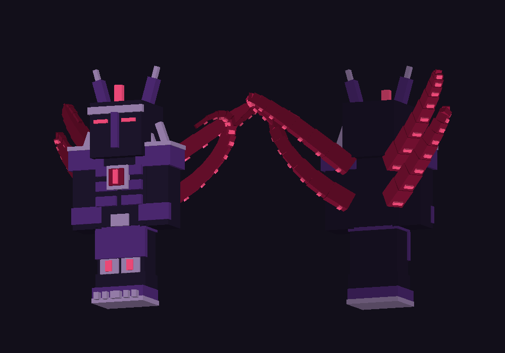

# Vestments of the Inevitability

An original LOTM/COI-inspired four-piece set: black and purple layered plates, a sealed crimson eye,
a pointed crown, spiked pauldrons, clawed boots, and four living crimson tentacles. The worn armor
uses a custom native humanoid rig; each inventory item also has its own volumetric model.
No external animation library is required.



This is a generated geometry preview of the actual rig and idle tentacle curves, using flat material
colors; Minecraft adds the pixel textures, lighting and movement. Regenerate it with
`python tools/model_gen/inevitability_armor/preview.py`.

## Obtaining and repairing

Craft **four Sealed Inevitability Cores** using this crafting-table pattern:

```text
Echo Shard    Amethyst Shard    Echo Shard
Ender Pearl   Nether Star      Ender Pearl
Echo Shard    Amethyst Shard    Echo Shard
```

At a smithing table, combine a **Netherite Upgrade Smithing Template**, the corresponding
**Netherite armor piece**, and **one core**. Repeat for helmet, chestplate, leggings and boots.
Smithing retains the base item's enchantments and custom data through vanilla smithing behavior.
Repair with **Echo Shards** in an anvil. The set is also in the **Sealed Artifacts** creative tab.

IDs: `circle_of_inevitability:inevitability_helmet`, `inevitability_chestplate`,
`inevitability_leggings`, `inevitability_boots`, and `inevitability_core` (same namespace).

## Combat

| Equipment | Reach | Damage per strike | Minimum strike interval |
| --- | --- | --- | --- |
| Chestplate, with any other armor | 3 blocks | 6 (3 hearts before mitigation) | 30 ticks / 1.5 seconds |
| All four pieces | 4 blocks | 8 (4 hearts before mitigation) | 20 ticks / 1 second |

The tentacles idle and curl continuously. They lash together at one nearby hostile after a
six-tick windup, then retract. Each successful strike consumes one chestplate durability.
The four tentacles are one attack, not four separate damage instances. Damage uses the wearer's
normal attack damage source, so kills have an owner and normal defenses and combat hooks apply.

Players, passive animals, unprovoked neutral mobs, pets, teams, marionettes and `/friend` allies
are spared. Neutral mobs attacking the wearer can be targeted. Targets must be alive, visible to
the mod's targeting rules, within reach and in line of sight, both at selection and at impact.
Removing/replacing the chestplate, death, spectator mode or an attack/ability restriction cancels
the pending attack. Re-equipping does not reset its cooldown. Removing other pieces during the
windup immediately removes their range/damage bonus.

All four pieces provide Netherite-equivalent armor, toughness and knockback resistance, with a
42 durability multiplier and 18 enchantability. Standard armor enchanting and fire-resistant
item behavior are retained. The set bonus works without selecting a pathway.

## Extending the implementation

- `item/armor/InevitabilityArmor.java`: material, set matching, and two immutable attack profiles.
- `item/armor/TentacleCombat.java`: reusable server tick/interrupt API. Supply an equipped source
  stack, a validated `Profile`, and a `BiPredicate<LivingEntity, LivingEntity>` target policy.
  Call once per server tick and `cancel(wearer)` when the power is disabled. Cooldowns are shared
  per wearer to prevent equipment-swap exploits. Current armor integration is in `tickArmor`.
- `item/armor/TentacleArmorItem.java`: shared item setup and set/slot identity. For a future set,
  provide its own client extension and material rather than using the Inevitability renderer.
- `client/armor/`: client-only native geometry and Bezier tentacle animation. A short attack
  snapshot in the chestplate's `minecraft:custom_data.coi_tentacle_strike` uses normal equipment
  synchronization. It carries a timestamp, dimension, duration and target point. Other custom
  data is preserved. Expired snapshots are ignored and removed at recovery/cancellation; old
  animations cannot cause damage. No client packet can trigger an attack.
- `assets/circle_of_inevitability/armor/inevitability.rig.json`: resource-pack editable bones,
  slots, UVs and cubes. Coordinates are model pixels, Y down; rotations are radians. Native
  humanoid bone names/pivots must remain present. Per-slot models retain only that slot's cubes.
  A resource reload rebuilds the models. The four tentacles use twelve tapered segments each.
- `tools/model_gen/inevitability_armor/generate.py`: dependency-free deterministic generator
  for rig, texture atlas, 3D item models, recipes, translations and tags. Edit this source for
  permanent changes; rerun `python tools/model_gen/inevitability_armor/generate.py`.

The attack animation aims at the position captured when windup begins; moving targets can evade
by leaving range or moving behind a wall. Combat state is transient and resets on server restart.
Armor follows normal humanoid poses. Non-humanoid entities need their own equipment renderer.

## Verification

```text
./gradlew build
./gradlew runGameTestServer -PinevitabilityArmorTests
```

The focused server suite covers equipment components, target exclusions, actual windup/damage/
durability/cooldown, full-set reach, removal during windup, walls, and becoming friends during
windup, plus all four real smithing recipes and component preservation. It uses an isolated world
under `build/inevitability-armor-gametest`. The build also runs `armorModelTest`, which bakes the
native models, checks that armor slots have separate geometry, exercises idle animation, and
verifies that all four tentacles reach the strike point and retract after the animation expires.
