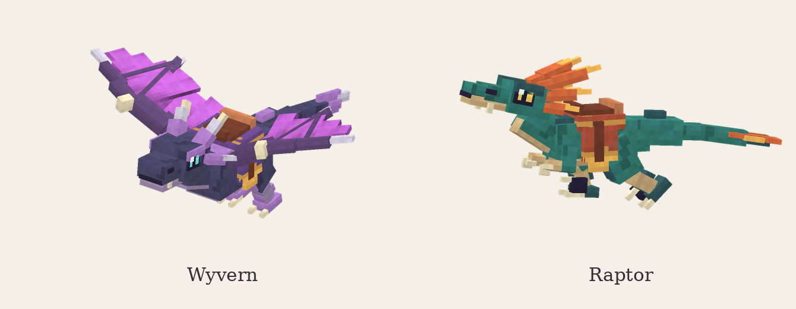

# Riding mounts



Use a whistle in open space to summon the mount beneath you. Steer with your movement keys. Dismount with your sneak key to dismiss it. You keep the whistle and can call the mount again.

| Mount | Shapeless whistle recipe | Riding controls |
| --- | --- | --- |
| Wyvern | Saddle + copper ingot + phantom membrane | Hold jump to take off. Fly forward while looking up or down to climb or dive. Release movement to slow to a hover. |
| Raptor | Saddle + copper ingot + feather | Run with the movement keys. Press jump on the ground to leap, or hold it to jump again after landing. |

Both whistles appear in **Tools & Utilities** in Creative. An operator can also place a mount with `/summon circle_of_inevitability:wyvern` or `/summon circle_of_inevitability:raptor`. Right-click a placed mount to ride it. Placed mounts stay in the world after dismounting.

## Call a mount from an ability

On the server, call the same method as the whistle. It checks space for both mount and rider, seats the player, and returns whether the ride started. Apply any ability cost or cooldown after a successful call.

```java
if (RidingMount.summon(player, Mounts.WYVERN)) {
    // Start this ability's cooldown.
}
```

## Add a mount

1. Add a breed in `mount/Mounts.java`. Registration creates the entity type, attributes, whistle, creative entry and client renderer. The final three arguments are hitbox width, hitbox height and saddle attachment height, in blocks.

   ```java
   public static final Breed BASILISK = register("basilisk", Gait.runner(0.30, 0.65), 1.2F, 1.6F, 1.36F);
   ```

   The runner arguments are the Minecraft movement speed and jump strength attributes. For a flying mount, use `Gait.flyer(0.058)`. Its argument controls acceleration per tick in air.

2. Under `assets/circle_of_inevitability/`, copy the nearest example into `mounts/basilisk.rig.json` and `textures/entity/mount/basilisk.png`. Both stock rigs use Minecraft box UVs, 16 model pixels per block, local pivots, and rotations in degrees. List parents before children. The riding animation uses these paths.

   ```text
   body
     neck/head
     tail/tip
     left_leg/shin
     right_leg/shin
     left_wing/tip       (optional wing pair)
     right_wing/tip
   ```

   New pieces follow the bone they are attached to. Attach a saddle to the body and align its upper surface with the breed's seat height. The two shipped rigs and their painted atlases can also be regenerated with `python3 tools/model_gen/mounts/generate.py` (Pillow required).

3. Copy a whistle's `items/`, `models/item/` and `textures/item/` files using the new `basilisk_whistle` name. Add the entity and item names to `lang/en_us.json`. To make it craftable, copy the recipe and recipe-book advancement under `data/circle_of_inevitability/` and update the ingredients, item and recipe IDs.

Run `./gradlew -PmountTests build runGameTestServer` to check the whistle lifecycle, raptor movement and wyvern flight.
