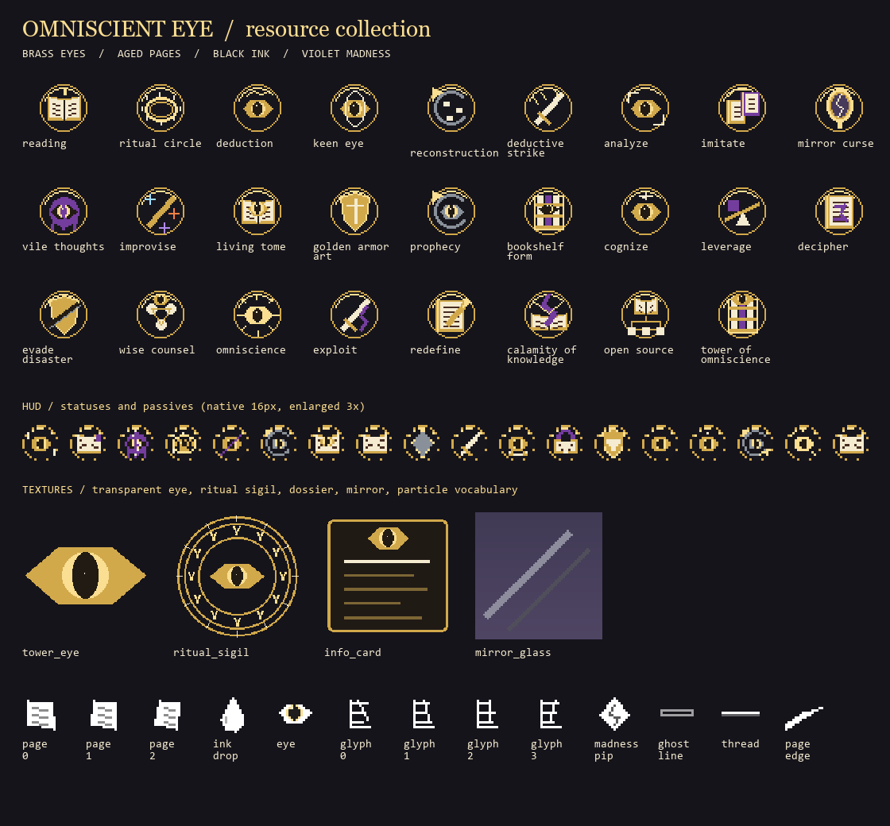
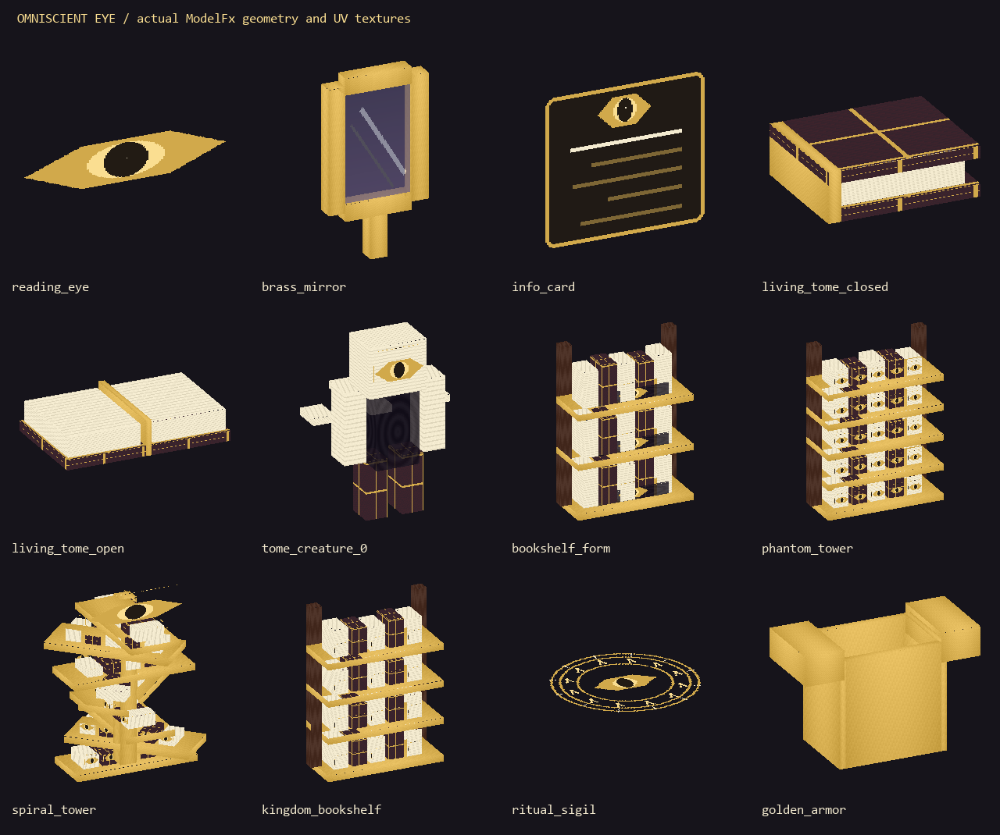

# Omniscient Eye assets

Resource implementation of the visuals in the supplied **Omniscient Eye: ability design** plan,
especially its “Looks and pictures” list. The palette is brass `#D1A94B`, aged cream `#F4EBD0`,
ink `#221B14` and deep violet `#733D9D`. Artwork and synthesized audio are original; no external
art, recordings or wiki imagery are bundled.

This update supplies resources and registers sound events. The pathway's abilities, targeting,
Codex persistence, dossier text, UI rendering and effect playback still need gameplay code.
The PDF's implementation checklist and questions are design context, not additional work performed here.





[Creature animation poses and spiral tower turntable](assets/omniscient_eye/turntable.gif)

## Inventory

All paths below are relative to `src/main/resources/assets/circle_of_inevitability/`.
The machine-readable inventory is [`omniscient_eye/asset_manifest.json`](../src/main/resources/assets/circle_of_inevitability/omniscient_eye/asset_manifest.json).
It maps every ability to its icons, cue and model choices, lists pivots/render settings,
and hashes the 155 individual asset files. Shared `sounds.json` and language files are additional.

| Resource | Location | Contents |
| --- | --- | --- |
| ModelFx geometry | `models/model_fx/omniscient_eye/` | 19 cube models; Blockbench Java Block/Item format |
| Model textures | `textures/model_fx/omniscient_eye/` | 13 PNGs plus ink-pool animation metadata |
| Ability icons | `textures/gui/ability_menus/omniscient_eye/` | 26 transparent 32 x 32 icons |
| HUD glyphs | `textures/gui/omniscient_eye/` | 44 transparent 16 x 16 ability/status/passive icons |
| HUD components | same folder | Three 8 x 8 madness pips, analysis bar background/fill, dossier and Codex panels |
| Pathway icon | `textures/gui/pathway_icons/omniscient_eye.png` | 16 x 16 eye-crowned tower |
| Particle sprites | `textures/particle/fx/omniscient_eye/` | 13 transparent, tintable 16 x 16 sprites |
| Sound cues | `sounds/omniscient_eye/` | 31 mono Vorbis cues, 22,050 Hz, with subtitles and Java registration |

The wheel icons cover exactly the planned **5 Mystic Arts + 5 Fate and Cognizing + 8 Omniscience**
entries. The other eight icons cover normal/sneak abilities on keys 1–4.

## Models and intended use

Every ID begins `circle_of_inevitability:model_fx/omniscient_eye/`. Front is north (-Z),
16 model pixels equal one block, and the asset manifest gives each pivot in model pixels.
All cubes stay inside Blockbench's -16 to 32 coordinate range.

| Model names | Use |
| --- | --- |
| `reading_eye`, `cognize_eye`, `tower_eye` | Small card eye, medium scrutiny eye, large Tower eye; distinct geometry sizes |
| `info_card` | Floating dossier ornament; its lines are decorative, not actual entity data |
| `brass_mirror` | Brass rim/handle and translucent glass inset; target reflection requires runtime rendering |
| `living_tome_closed`, `living_tome_open` | Closed book and two-page opening prop |
| `tome_creature_0` through `_3` | Page-and-ink construct, one brass eye, four compatible animated poses |
| `bookshelf_form` | Incomplete form with black eye-pools between books |
| `phantom_tower` | Complete tower of eye-bearing books |
| `spiral_tower` | Pinnacle form: seven tiers winding around a central spine and a crown eye |
| `kingdom_bookshelf` | Repeated bookcase prop for the Tower's kingdom haze |
| `ritual_sigil` | Double-sided ground sigil with transparent background |
| `ghost_outline` | Translucent wireframe proxy for foreseen/replayed casts; tint by pathway |
| `golden_armor` | Thin open armor shell for Golden Armor Art |
| `force_spear` | Recolorable Improvise projectile |

The creature and other eyes have transparent texture areas: use `.seeThrough()`.
For flat eyes, cards, sigils and the ghost use `.glow().unshaded().seeThrough()` and no aura,
because an aura follows cube bounds and would make a glowing rectangle around transparent sprites.
For solid books/mirrors use ordinary shading with `.glow()` if needed. Armor opacity and
the phantom form's translucency are supplied by `ModelFx.color(...)` at runtime.

Animate the creature with `ModelFx.of("omniscient_eye/tome_creature").frames(4).smooth()`;
the base name intentionally has no separate JSON, following ModelFx's numbered-frame convention.
All four frames have matching cube names, face topology and materials. The ink-pool texture
has four vertical frames with interpolation and three ticks per frame.
The supplied GIF shows each pose and a model turntable; it is a review artifact, not a Minecraft animation format.

Use `.scale(3.2f)` on `phantom_tower` for the plan's six-block form (30 model pixels x 3.2 / 16 = 6).
Place `tower_eye` above the pinnacle and use the `thread` sprite with `SpellFx.tether` for its scan beam.
Ritual sigil geometry is 32 pixels wide: `.scale(2)` gives a four-block circle.
Dynamic growth, fades, scan sweeps and world placement use ModelFx keys in the future ability code.

For reconstruction and prophecy, `ghost_outline` is a generic fallback. Replaying an actual cast's
shape still uses its recorded `ParticleShapes.model` geometry from the existing spell kit.
The shared rune-circle, closing-ring, tether, overhead-number and SlashFx systems provide
line rendering, countdowns and melee animation; the new particle textures give them this pathway's motifs.

## HUD and particles

The dossier panel is 128 x 80; the Codex panel is 256 x 192. Both have a blank body for dynamic
text and a 24-pixel header. The analysis background is 104 x 8 with a 100 x 4 inner fill,
positioned at offset (2, 2); crop the fill by percentage. Display ten madness pips, selecting
empty/filled/critical from the counter. No pre-rendered health, names or analysis percentages are baked in.

Particle IDs begin `fx/omniscient_eye/`: `page_0..2`, `ink_drop`, `eye`, `glyph_0..3`,
`madness_pip`, `ghost_line`, `thread`, `page_edge`. Pages/glyphs are white or grayscale for
`ParticleFx.color(...)`; tint drops ink-black, madness violet and eyes brass.
Use the three page variants, eye glyphs, ink and page-edge sprites for the optional melee combo.
Passives with no bespoke world effect have HUD symbols; they need no separate models.

## Sounds

There is one cue per ability and five auxiliary cues: `page_turn`, `codex_learn`, `tome_break`,
`madness_break`, `tower_end`. IDs are `circle_of_inevitability:omniscient_eye.<name>`.
Select registered events through `ModSounds.OMNISCIENT_EYE.get("<name>")`.
These are short synthesized page rustles, brass chimes and ink/madness pulses, not speech or looping ambience.
Analysis countdowns remain silent: the `analyze` cue is intended for successful completion.

Preview resources in a development client:

```mcfunction
/particle circle_of_inevitability:model{model:"circle_of_inevitability:model_fx/omniscient_eye/spiral_tower",glow:1b,lifetime:200} ~ ~ ~ 0 0 0 0 1
/particle circle_of_inevitability:fx{textures:["circle_of_inevitability:fx/omniscient_eye/page_0"],color:"FFF4EBD0",glow:1b,size:0.3f} ~ ~1 ~ 1 1 1 0 30
/playsound circle_of_inevitability:omniscient_eye.living_tome master @s ~ ~ ~ 1 1
```

## Regeneration and validation

Requires Python 3 with Pillow and `ffmpeg`/`ffprobe` on PATH. Geometry, pixels and synthesis
use fixed inputs and seeds. Ogg container stream serials may vary across encodes; the manifest hashes
record the actual packaged files. The generator preserves other pathways' sound events and translations.

```powershell
python tools/model_gen/omniscient_eye/generate.py
python tools/model_gen/omniscient_eye/preview.py
python tools/model_gen/omniscient_eye/validate.py
./gradlew build
```

Validation checks inventory hashes, texture references, dimensions, alpha, legal cube bounds/rotations/UVs,
unique wheel icons, animation topology, subtitles, Java sound registration and full audio decoding with
non-silent, unclipped samples. Model previews render the generated geometry and UV textures with a small
orthographic software renderer. Final blending, sound balance and placement need an in-game review.
