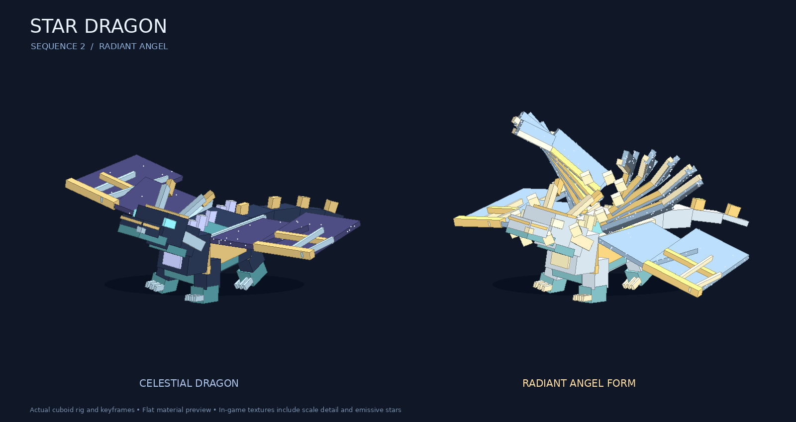

# Star Dragon bosses: Sequence 2 and Sequence 0

Animated **Radiant Angel (Sequence 2)** and **Condenser (Sequence 0)** encounters in the Star Dragon pathway. Summon either with:

```mcfunction
/stardragon summon ~ ~ ~8
/stardragon summon_condenser ~ ~ ~8
```

Entity IDs: `circle_of_inevitability:star_dragon_boss` (Sequence 2) and
`circle_of_inevitability:star_dragon_condenser_boss` (Sequence 0). Vanilla `/summon` also works. Each starts at
its own fixed Sequence, persists without despawning, shows a tracking boss bar, and drops its own Sequence's
characteristic through the existing Beyonder loot system. There is no natural spawn rule or new dependency.



[Animation preview](assets/star_dragon_boss/animations.gif) uses the actual rig and keyframes with flat
materials. The game applies the supplied scale textures and emissive maps. The normal body is a celestial
dragon; the Radiant Angel form unfolds six pairs of wings, a halo, gold-white materials, and flight.

## Sequence 0: hard Condenser encounter

The Condenser adds all six Sequence 1/0 powers to the twenty earlier abilities. It uses the same editable
animated dragon and radiant-angel assets, with actual enlarged Star Dragon Form and collision-checked flight.
It has finite health (1000 base, 1004 with Star's Embrace), 16 armor, a base 20-damage bite, and ordinary damage
can kill it. Spell damage defaults to 0.85 of the shared spell numbers, before the existing player-damage scale.
It has no resurrection or blanket invulnerability. Silence interrupts windups and all normal casting checks remain.

Pressure comes from short pauses and attack chains:

- Select attacks every 2 ticks; normal recovery is 6 ticks (0.3 seconds), or 8 ticks for Planetfall/Singularity.
- Telegraph attacks for 10–32 ticks, retaining the shared spell's own warning effects and travel times.
- Below half health, windups take 70% as long and recovery takes 50% as long (3–4 ticks).
- Prefer configured follow-ups: Time Dilation → Planetfall, Fission Pulse → Planetfall, and Piercing Ray → Fusion Cluster.
- A disabled, cooling down, unaffordable, or unreachable follow-up is skipped immediately. Alternative attacks continue.

| Additional ability ID | Power |
| --- | --- |
| `Star Dragon/7/time_dilation` | Gravitational Time Dilation: slow enemies and projectiles in a field |
| `Star Dragon/7/planetfall` | Planetfall: falling planetary bombardment |
| `Star Dragon/7/star_dragon_form` | Enlarged Star Dragon Form with damage reduction, glow and flight |
| `Star Dragon/7/neutron_star` | Neutron Star: temporary damage reduction and nearby crushing field |
| `Star Dragon/7/singularity` | Singularity: projectile-swallowing black hole with bounded core damage |
| `Star Dragon/7/quantum_uncertainty` | Quantum Uncertainty: enemy misses and displaced teleports |

The boss's Singularity replaces the player's self-sacrifice price: its animated windup is the gather phase,
then it pays 15000 spirituality and 6% of maximum health (never below 1 health), with only a 6-tick ability lock.
It becomes eligible between 8% and 70% health and has a 600-tick cooldown. Each core hit is capped at 24 damage
before encounter/player scaling; the shared 15%-of-target-health rule can make that lower. Other abilities can
follow while the field persists. Player and generic mob Singularity retain their original price and gathering.

Sequence 0 costs are tuned below the mob's 39200 spirituality capacity, including Neutron Star, which would
otherwise exceed that capacity. Fusion Cluster costs 12500. Gravity Authority slows nearby hostile projectiles;
Condenser footstep effects also run. Forms remain temporary and mutually exclusive. The shared mob version of
Star Dragon Form still has no orbiting melee asteroid. `/beyondermob cast` is a debug override and runs the
original shared spell, including the original Singularity self-sacrifice; use `/stardragon cast` for this encounter.

## Directing a boss

All commands require permission level 2 and work on either boss. Use the Condenser entity ID in the selector
when directing Sequence 0. Tag a boss once to keep subsequent selectors short:

```mcfunction
/tag @e[type=circle_of_inevitability:star_dragon_boss,sort=nearest,limit=1] add my_dragon
/stardragon mode @e[tag=my_dragon] manual
/stardragon target @e[tag=my_dragon,limit=1] @p
/stardragon cast @e[tag=my_dragon,limit=1] "Star Dragon/3/sneak" @p
```

A creative or spectator player is not a combat target. Use Survival to test damage.

| Command | Behavior |
| --- | --- |
| `/stardragon summon [x y z]` | Spawn a Sequence 2 boss |
| `/stardragon summon_condenser [x y z]` | Spawn the hard Sequence 0 boss |
| `/stardragon mode <bosses> auto` | Select attacks, pursue, bite, and hover in radiant form |
| `/stardragon mode <bosses> manual` | Stop pursuit and automatic attacks; allow directed casts |
| `/stardragon mode <bosses> passive` | Stop combat, end the current form, cancel queued attacks and periodic passives |
| `/stardragon target <boss> <target>` | Keep a particular living target selected |
| `/stardragon clear_target <boss>` | Release the target lock |
| `/stardragon cast <boss> "<ability id>" <target>` | Start that attack's animated windup, respecting combat checks |
| `/stardragon enable <boss> "<ability id>" false` | Disable that attack on this boss; `true` restores it |
| `/stardragon weight <boss> "<ability id>" 30` | Change that boss's relative selection weight; zero removes automatic selection |
| `/stardragon reset <boss>` | Clear attack overrides and cooldowns, refill spirituality, cancel the windup |
| `/stardragon info <boss>` | Show mode, health, spirituality, attack settings and casting readiness |
| `/stardragon reload` | Validate config and apply it to every loaded boss without healing it |

Mode, target UUID, disabled attacks and weight overrides are saved with each entity. Pending windups are
cancelled when modes change or the entity unloads; they are never replayed on load. Existing saved bosses
also receive current profile stats on load without health or spirituality refills. The standard `NoAI`
flag stops the encounter, including periodic passives. Commands work from command blocks and functions.

`manual` retains periodic pathway passives. Use `passive` when the boss should not hurt nearby creatures.
Attacks already released can finish their shared timed effects after a mode change. To suppress the spell damage
from those effects as well, set `ability_damage_multiplier` to zero and reload.

The existing `/beyondermob cast` remains an explicit debugging override: it bypasses normal costs, cooldowns,
range and selection settings. Its sequence check remains intact, and it still triggers the boss animation.

## Tuning without recompiling

The first server start writes these independent profiles:

| Encounter | Editable config under `config/circle_of_inevitability/` | Bundled default under `data/circle_of_inevitability/bosses/` |
| --- | --- | --- |
| Sequence 2 | `star_dragon_boss.json` | `star_dragon.json` |
| Sequence 0 | `star_dragon_condenser_boss.json` | `star_dragon_condenser.json` |

Edit the appropriate config, then run `/stardragon reload`. Both profiles validate before either goes live.
Bad JSON, out-of-range values, unknown attack/follow-up IDs, or powers above the profile's Sequence are rejected;
the last valid profiles remain in use. This is a config file, not a datapack reload listener.

Global settings (defaults below are for Sequence 2; the Sequence 0 profile sets its own values):

| Field | Default | Meaning |
| --- | --- | --- |
| `health` | 600 | Base maximum health (1–1024, the vanilla limit); Star's Embrace adds its inherited 4 health within that limit |
| `melee_damage` | 14 | Base bite damage, before Strength/armor |
| `ability_damage_multiplier` | 1 | Scale all shared spell damage from this boss, including delayed damage |
| `movement_speed` | 0.25 | Ground navigation speed |
| `follow_range` | 48 | Maximum automatic encounter range |
| `think_ticks` | 10 | Automatic selection interval |
| `recovery_ticks` | 45 | Fallback recovery for future abilities without an explicit entry |
| `enraged_below` | 0.4 | Below this health fraction, prefer key 6/7 powers |
| `enraged_weight_multiplier` | 1.5 | Multiply key 6/7 selection weights in that phase |
| `passives` | true | Tick pathway body, senses, regen and Radiance; enable melee Fission Touch |
| `radiant_flight` | true | Enable actual collision-checked hovering in Radiant Angel form |
| `hover_height` | 4 | Preferred feet elevation above the target while hovering |
| `enraged_windup_multiplier` | 1 | Scale windup duration below `enraged_below`; Sequence 0 uses 0.7 |
| `enraged_recovery_multiplier` | 1 | Scale recovery duration in that phase; Sequence 0 uses 0.5 |

Each entry under `attacks` has:

```json
"Star Dragon/3/sneak": {
  "enabled": true,
  "weight": 14,
  "windup_ticks": 24,
  "recovery_ticks": 45,
  "cooldown_ticks": 160,
  "cost": 2450,
  "range": 28,
  "min_health": 0,
  "max_health": 1,
  "animation": "ray",
  "followups": ["Star Dragon/7/fusion_cluster", "Star Dragon/6/sneak"]
}
```

`followups` is optional (default empty). After this move succeeds, automatic combat tries the listed moves
in order at its next decision, then falls back to weighted selection. Every enabled, health, range, cost,
cooldown, sequence and blocker check still applies. A zero per-boss weight also prevents automatic follow-up
selection; a manual command can still cast it. Edit these lists to change combos without recompiling.

Sequence 0 also accepts a `singularity` object with `health_cost_fraction` (default 0.06), `spent_ticks` (6),
and `damage_cap` (24). These customize only its encounter version, alongside the usual attack cost, cooldown,
health limits and windup. The normal Sequence 2 config does not grant access to this ability.

Twenty ticks are one second. Weights are relative among eligible attacks. `cost` is charged once when
an attack releases successfully. Health limits are fractions of maximum health. `range` is a selection
limit; the shared spell still uses its own physical range, radius and damage constants. To increase a
spell's physical reach or change its individual damage/status behavior, edit its constants in the
characteristic's `StarDragonRays`, `StarDragonGravity`, `StarDragonSky`, `StarDragonVoid`, `StarDragonTides`,
or `StarDragonForms` class. The global damage multiplier offers live encounter balancing.

A new eligible ability registered in `StarDragonMobs` is automatically available with inherited
cost/cooldown/range and a default cast animation. Add a config entry to customize it. Tuning copies each
`MobAbility`; it never mutates the registry used by players or other mobs. Removing a config entry restores
those inherited settings. Per-boss command overrides still apply after a config reload; `/stardragon reset`
clears them. Disabling an attack in the global config cannot be bypassed by per-boss enable commands.

Windups spend nothing. Release rechecks sequence, spirituality, cooldown, range, sight, status blockers,
and the spell's predicate. A dead, missing, invalid or out-of-range target cancels the cast without payment.
Silence/ability locks interrupt it. Recovery follows successful casts; the boss never runs the generic
random mob casting brain in parallel. A global `BeyonderMobRules.MOBS_CAST=false` also stops boss casts.

The shared `BeyonderMobRules` settings for spirituality, regeneration, cooldown scaling, player damage and
block changes remain in effect. Block-changing abilities respect the existing mobGriefing checks.

## Complete Sequence 2 moveset

| ID | Power |
| --- | --- |
| `Star Dragon/1` | Star Chart |
| `Star Dragon/1/sneak` | Fate Glimpse |
| `Star Dragon/2/gravity_abnormality` | Gravity Abnormality |
| `Star Dragon/2/electromagnetic_attraction` | Electromagnetic Attraction |
| `Star Dragon/2/cosmic_void` | Cosmic Void |
| `Star Dragon/2/weakening_ray` | Weakening Ray |
| `Star Dragon/2/sunlight_ray` | Sunlight Ray |
| `Star Dragon/3` | Void Passage |
| `Star Dragon/3/sneak` | Piercing Ray |
| `Star Dragon/4` | Tidal Surge and its melee parry |
| `Star Dragon/4/sneak` | Scaled Form / Heavy Body |
| `Star Dragon/5/heavybringing` | Heavybringing |
| `Star Dragon/5/fate_convergence` | Fate Convergence |
| `Star Dragon/5/heavy_sphere` | Heavy Sphere |
| `Star Dragon/5/series_of_rays` | Series of Rays |
| `Star Dragon/5/remote_sight` | Remote Sight: extended sensing through walls |
| `Star Dragon/6` | Star Grazing |
| `Star Dragon/6/sneak` | Fission Pulse |
| `Star Dragon/7/fusion_cluster` | Fusion Cluster |
| `Star Dragon/7/radiant_angel_form` | Radiant Angel Form, including burning glow, damage boosts and hovering |

Inherited periodic traits include Stargazing, nearby hidden-target sensing (the mob equivalent of
Spiritual Intuition and Sense of Passages), Star's Embrace, Starlight Scales, Dense Body, Fission Touch,
and Radiance. Perception does not remove line-of-sight requirements from attacks that require them.
For the Sequence 2 encounter, Sequence 1 and 0 powers remain locked, including the separately named **Star Dragon Form**: this boss's
normal dragon appearance does not grant that Sequence 1 transformation.

## Assets and animation editing

All runtime assets are under `assets/circle_of_inevitability/`:

| Asset | Purpose |
| --- | --- |
| `boss/star_dragon/star_dragon.rig.json` | Runtime native cube rig: 57 bones, 128 cubes, local Java-model coordinates |
| `boss/star_dragon/star_dragon.animations.json` | Runtime additive keyframes for idle, walk, cast, ray, surge, ward, transform, bite, hurt, death and radiant |
| `boss/star_dragon/star_dragon.geo.json` | Bedrock geometry import for Blockbench, including box UVs |
| `boss/star_dragon/star_dragon.animation.json` | Corresponding Bedrock animation export for editing/reference |
| `textures/entity/star_dragon_boss/normal.png` | 512×512 indigo, silver-teal and gold material atlas |
| `textures/entity/star_dragon_boss/radiant.png` | 512×512 radiant white-gold atlas |
| `textures/entity/star_dragon_boss/*_emissive.png` | Separate eyes/star/constellation masks for both forms |

Runtime rendering uses Minecraft's native `EntityModel`, `MobRenderer`, and an emissive layer.
No GeckoLib dependency is needed. Bone transforms and cube origins use model pixels (16 per block),
with parent-local pivots and XYZ Euler rotations in degrees. Parents must appear before children.
Animation keyframes are `[normalized_time, x, y, z]`; supported channels are `rotation`, `position`,
and `scale`. Tracks interpolate with smoothstep. Loop lengths use seconds. Idle layers under walking,
attacks and radiant motion. Hurt and death layer last. Server animation start times use synchronized
world time so clients tracking a boss later in a fight see the same attack phase.

Resource packs can override the rig, textures and keyframes; F3+T reloads them. Available attack animation
names in the server config are `cast`, `ray`, `surge`, `ward`, `transform`, and `bite`. If you add another
attack animation, also extend the validation list in `StarDragonBossSettings.parse`.

For Blockbench, import `star_dragon.geo.json` as a Bedrock model and select the matching PNG atlas.
The Bedrock files are editable exports; the Java renderer consumes `.rig.json` and `.animations.json`.
Transfer edits into the runtime JSON or change the generator; there is no automatic Blockbench round trip.

The boss reuses the mod's existing Star Dragon spell models, particles and sounds. Windup uses the vanilla
amethyst resonance and hurt/death use vanilla dragon audio. All new mesh and texture assets are generated
locally by `tools/model_gen/star_dragon_boss/generate.py`; the seeded generator is deterministic.

```sh
python tools/model_gen/star_dragon_boss/generate.py
python tools/model_gen/star_dragon_boss/validate.py
python tools/model_gen/star_dragon_boss/preview.py
./gradlew build
./gradlew runGameTestServer -PstarDragonBossTests
```

Python asset tools require Pillow. Validation checks hierarchy, UV overlap and coverage, texture dimensions,
all animation tracks and the attack-to-animation mapping. GameTests exercise identity/sequence gates,
windup payment, interruption, manual controls, characteristic loot, saved controls/resources/gravity, and isolated encounter cost tuning. Additional Sequence 0 tests exercise all six higher-sequence releases,
automatic chains, disabled follow-ups, accelerated enrage/recovery, interruption, finite costs/damage,
Sequence 0 loot and persisted identity.
The normal Gradle build also runs the repository's existing swing animation checks.

Combat balance and final movement/appearance should be playtested in a Minecraft client.
