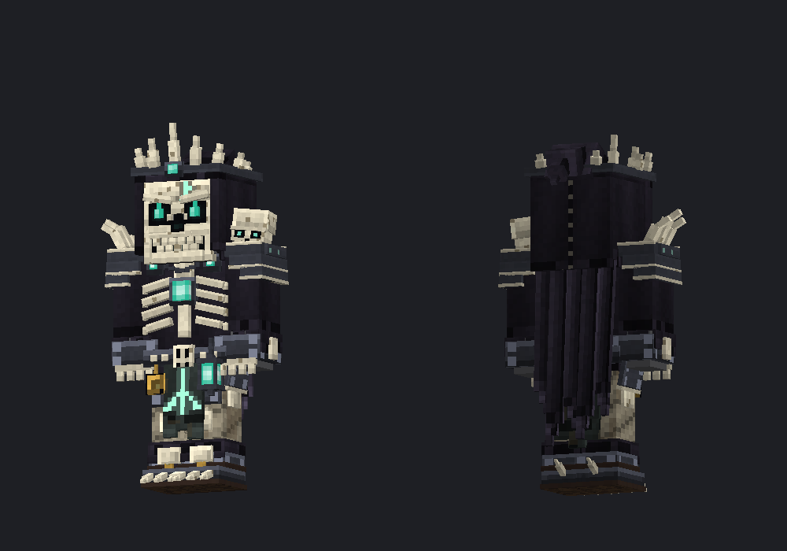

# Vestments of Death

A Death-pathway companion to the [Inevitability](INEVITABILITY_ARMOR.md), [Unshadowed](UNSHADOWED_ARMOR.md) and
[Gray Fog](GRAY_FOG_ARMOR.md) sets, and the only one that bites back. It reaps everything hostile around its wearer
and drags it underground, but it starves them, wounds them and must be fed. Worn whole, it summons a Spirit Guide
and slowly takes their life.



Textured preview of the rig at rest (regenerate it with `python tools/model_gen/death_armor/preview.py`).

| Piece | Look |
| --- | --- |
| **Death Consul's Visage** | A deep reaper's hood whose point droops behind the head. Inside it, a scowling skull mask built bone by bone: real eye sockets with soul-fire eyes, a nose cavity, two rows of teeth on a hinged jaw, and a seam of soul-light splitting the forehead. Above it all the Pale Emperor's crown: a blackened circlet with nine bone spikes and a soul gem. |
| **Pale Emperor's Mantle** | A black robe under an open ribcage, with the soul heart burning in an iron setting where the sternum would be. A chain droops between two soul clasps. Layered iron pauldrons with a fan of bone claws on the right shoulder and a small skull on the left. Tattered sleeves over iron bracers and finger bones, a soul lantern hanging at the left hip, and a cape torn into five strips. |
| **Ferryman's Shroud** | An iron belt with a skull buckle and the Ferryman's obol on a chain. Grave-green panels hang in front and behind, the front one marked with the death rune (Yr). The legs are bound in old bandages under bone kneecaps and iron tassets. |
| **Gravedigger's Treads** | Iron boots caked with grave dirt, with tattered cuffs, bone shin guards, three clawed toes and a heel spur. |

What moves (`client/armor/DeathArmorModel.java`): the cape strips swing with the legs and flutter, the lantern and
the obol swing on their chains, the shroud panels are pushed by the stride, the hood's point sways, the eyes
flicker and the heart beats twice every 1.5 s. On every Reaping pulse the jaw drops, and the eyes and the heart flare; each piece reacts to its own pulse.

## Obtaining

Craft **four Ferryman's Obols**:

```text
Bone Block    Wither Skeleton Skull   Bone Block
Echo Shard    Nether Star             Echo Shard
Bone Block    Wither Skeleton Skull   Bone Block
```

At a smithing table, combine a **Netherite Upgrade Smithing Template**, the matching **Netherite armor piece** and
**one obol**. Every piece is **Unbreakable**: it never loses durability, even when made from a worn Netherite piece.
The set is in the **Sealed Artifacts** creative tab.

IDs: `circle_of_inevitability:death_helmet`, `death_chestplate`, `death_leggings`, `death_boots` and `death_core`.

## Powers

Every piece carries the full power and the full curse. The more pieces you wear, the stronger both get:

| Pieces worn | 1 | 2 | 3 | 4 (full set) |
| --- | --- | --- | --- | --- |
| Reaping reach | 4.5 blocks | 6 | 7.5 | 9 |
| Reaping damage | 1.5 | 2 | 2.5 | 3 |
| Reaping pulse | every 2.5 s | 2 s | 1.5 s | 1 s |
| Hunger | I | I | II | III |
| Pangs | about every 40 s, up to 2 damage | 20 s, up to 3 | 13 s, up to 4 | 10 s, up to 5 |
| The toll: a kill every | 10 min | 6 min 40 s | 5 min | 4 min |
| Spirit Guide and the ebb | | | | yes |

| | Effect |
| --- | --- |
| **Reaping** (any piece) | Every pulse hits every hostile mob in sight within reach, plus anything hunting you, for the same damage whatever the distance. Distance changes the marks: within 2.5 blocks a pulse gives **3 marks**, within 5 blocks **2**, further out **1**. Allies, pets and passive mobs are never touched. Marks fade one at a time, one every 3 s you leave the mob alone. Tiny skulls over a mob's head show how many it carries. Every worn piece shows the pulse: the jaw drops, the eyes and heart flare. |
| **Claimed by the underworld** | A mob with more than **6 marks** is seized by four arms of the dead. They drag it under the ground, where it takes **30 damage** in three crushes. If it survives, it is thrown out of the ground. The underworld
remembers every mob it has claimed: the second claim of the same mob crushes for **2×** (60), the third for **3×**
(90), the fourth for **4×** (120), and so on. The count stays with the mob, even across saves. Anything too big to bury is crushed where it stands. Whatever dies down there drops its loot on the surface. |
| **Spirit Guide** (full set) | A small wraith floats at your shoulder. Every 1.25 s it hurls a glowing soul skull, jaw open and trailing soul fire, at the nearest hostile within 7 blocks: 6 damage and 2 marks. It never attacks passive mobs. |

## The price

| | Effect |
| --- | --- |
| **Endless hunger** (any piece) | Hunger while worn, stronger with more pieces (see the table). |
| **Pangs** (any piece) | Now and then a sudden pain hits through armor, more often and harder with more pieces. A pang never takes your last half heart. |
| **The toll** (any piece) | The Vestments must be fed a kill in time (see the table). Any living thing you kill counts: a sword, an arrow, a pulse, the drag, the Spirit Guide. A **Toll** clock beside the hotbar shows the real time left at the pieces you are wearing. It speeds up when you put more on and slows down when you take some off. It warns you with 60 s and 30 s left, then with a heartbeat for each of the last 10, 5, 4, 3, 2 and 1 s. If the clock runs out, the armor **kills you**. Nothing saves you, not even a Totem of Undying. Taking every piece off pauses the clock where it is; putting one back on carries on from there, so it cannot be reset that way. The clock stops in Peaceful, where nothing can be killed, and dying resets it. |
| **The ebb** (full set) | Your max health falls by half a heart every 15 s. With nothing left to give, the armor takes you. Take any piece off and it returns half a heart every 10 s. Dying also gives it all back. |

Creative and spectator players carry no curse. Armor stands only display the set.

Protection, toughness, knockback resistance and enchantability match the other three sets; unlike them, it never breaks.

## Tuning and reuse

Every number above is a public constant at the top of `item/armor/DeathArmor.java` (`REACH`/`REACH_PER_PIECE`,
`PULSE_DAMAGE`, `PULSE_TICKS`, `RINGS`, `MARK_LIMIT`, `CLAIM`, `CLAIMS`, `HUNGER`, `PANG_CHANCE_PER_PIECE`, `TOLL_TICKS`,
`EBB_TICKS`, and the rest); `reach`, `pulseDamage`, `pulseTicks`, `pangChance`, `pangMax`, `tollRate` turn them
into the per-piece values. The general parts live where any set or
ability can use them, documented in the [spell kit](../SPELL_KIT.md):

- [`DragUnder`](../SPELL_KIT.md#dragunder) (`combat/`): the arms, burial, crushing and the throw, and `escalates(...)` for
  drags that hit harder every time they take the same target.
- [`KillToll`](../SPELL_KIT.md#killtoll) (`status/`): "feed it a kill or else", with warnings, a HUD clock, a rate for a
  clock that runs faster, and pause on unequip.
- [`MaxHealthDrain`](../SPELL_KIT.md#maxhealthdrain) (`status/`): max health taken and given back, per source.
- [`FollowerSummon`](../SPELL_KIT.md#followers-that-guard-the-caster) (`combat/`) gained `targets(...)`, `onStrike(...)`
  (what a strike looks like), `onHit(...)` and `isActive(...)` for summons that last while something is worn.
- `status/Marks` and `SpellFx.overHead` for the marks, `status/Burial`, which now returns the dead to the surface.

## Implementation

- `item/armor/DeathArmor.java`: material, set matching and every power and curse (its own event subscriber).
- `client/armor/DeathArmorModel.java`: every animation, applied on top of each bone's baked pose.
- `assets/circle_of_inevitability/armor/death.rig.json`: resource-pack editable rig. The model looks up `hood_tip`,
  `jaw`, `eye_left`, `eye_right` (head) and `heart`, `lantern`, `cape_0`…`cape_4`, `shroud_front`, `shroud_back` and
  `obol` (body). Keep those names.
- `tools/model_gen/death_armor/generate.py`: deterministic generator for the rig, the painted atlas, the item models,
  recipes, damage types, translations and tags. Every cube gets its own box-UV island in the atlas. Each face is
  painted on its own, at twice Minecraft's usual texel density: bevelled edges, bone grain, cloth folds, bandage
  windings, rivets, and decals (`skull_face`, `teeth`, `crack`, `coin`, `sigil`, `seam`, `runes`). Add a cube with
  `cube(bone, slot, origin, size, material, decal)` and it is packed and painted for you.
- Damage types `death_toll` (unstoppable) and `death_curse` (through armor), with their death messages.

## Verification

```text
./gradlew build                      # includes deathArmorModelTest
./gradlew runGameTestServer -PdeathArmorTests
```
