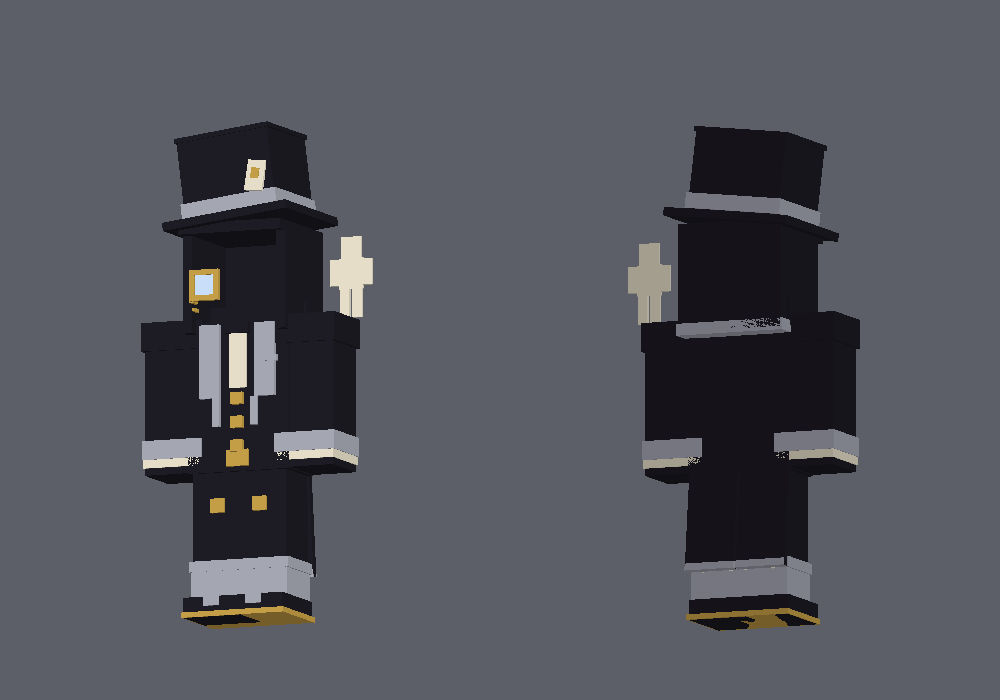

# Vestments of the Gray Fog

A Fool-pathway companion to the [Inevitability](INEVITABILITY_ARMOR.md) and [Unshadowed](UNSHADOWED_ARMOR.md)
sets. Nothing in this set attacks: each piece is one step up the pathway and has a power of its own, and the
four together let the wearer step into the gray fog. A black top hat worn at a tilt with a Fool tarot card in
its band, a gold monocle, a tailcoat whose tails swing with your stride, harlequin trousers and spatted shoes.
A paper figurine floats at your left shoulder while the Paper Substitute is ready.



Generated geometry preview of the rig and the idle figurine with flat material colors (the trousers' harlequin
diamonds are in the texture, not the preview). Regenerate it with `python tools/model_gen/gray_fog_armor/preview.py`.

## Obtaining and repairing

Craft **four Cards of the Fool**:

```text
Amethyst Block     Eye of Ender   Amethyst Block
Phantom Membrane   Nether Star    Phantom Membrane
Amethyst Block     Eye of Ender   Amethyst Block
```

At a smithing table, combine a **Netherite Upgrade Smithing Template**, the corresponding **Netherite armor
piece** and **one card**. Repair with **Phantom Membrane** in an anvil. The set is in the **Sealed Artifacts**
creative tab.

IDs: `circle_of_inevitability:gray_fog_helmet`, `gray_fog_chestplate`, `gray_fog_leggings`, `gray_fog_boots`,
and `gray_fog_core`.

## Powers

| Piece | Power | Effect |
| --- | --- | --- |
| Seer's Top Hat | Spirit Vision | Every mob hunting you within 24 blocks glows, and so does anything invisible within 16. When a new mob locks on, a chime only you can hear warns you. |
| Magician's Tailcoat | Paper Substitute | A hit that would kill you, or take 40% of your max health, is cancelled. The figurine burns where you stood and you blink about 5 blocks away from the attacker, with a second of grace. Costs 3 durability; recharges in 60 s (40 s with the full set). The figurine is gone from your shoulder until then. |
| Clown's Trousers | Acrobatics | 20% chance (30% with the full set) to dodge a melee swing or projectile outright, then Speed II for 1.5 s. Fire, falls, explosions and the like cannot be dodged. |
| Marionettist's Shoes | Strings from Above | No fall damage. Hold sneak while falling to drift down slowly. |
| **Full set** | Above the Gray Fog | Crouch without moving for 1 s to vanish into the fog ([Concealment](../../src/main/java/net/lukario/circleofinevitability/status/Concealment.java)): unseen, untouchable, and forgotten by mobs. Standing up or attacking steps back out; it lasts at most 10 s, then needs 15 s before the fog takes you again. |

Paper Substitute runs after Concealment and after any substitute armed by an ability, so neither uses the
figurine up; a Decree forbidding stand-ins stops it (and counts as a Violation). The recharge is kept on both the
coat and the wearer, so swapping coats cannot skip it.

Protection, toughness, knockback resistance, durability and enchantability match the other two sets.

## Implementation

- `item/armor/GrayFogArmor.java`: material, set matching and every power (its own event subscriber; the set does
  not use `TentacleCombat`).
- `client/armor/GrayFogArmorModel.java`: coat tail sway and the figurine, which is built in code and hidden while
  the coat's `coi_paper_ready_at` game time lies in the future.
- `assets/circle_of_inevitability/armor/gray_fog.rig.json`: resource-pack editable rig. The model looks up the
  `coat_tail_left` and `coat_tail_right` bones (children of `body`); keep those names.
- `tools/model_gen/gray_fog_armor/generate.py`: deterministic generator for the rig, texture atlas, item models,
  recipes, translations and tags.

## Verification

```text
./gradlew build                      # includes grayFogArmorModelTest
./gradlew runGameTestServer -PgrayFogArmorTests
```
