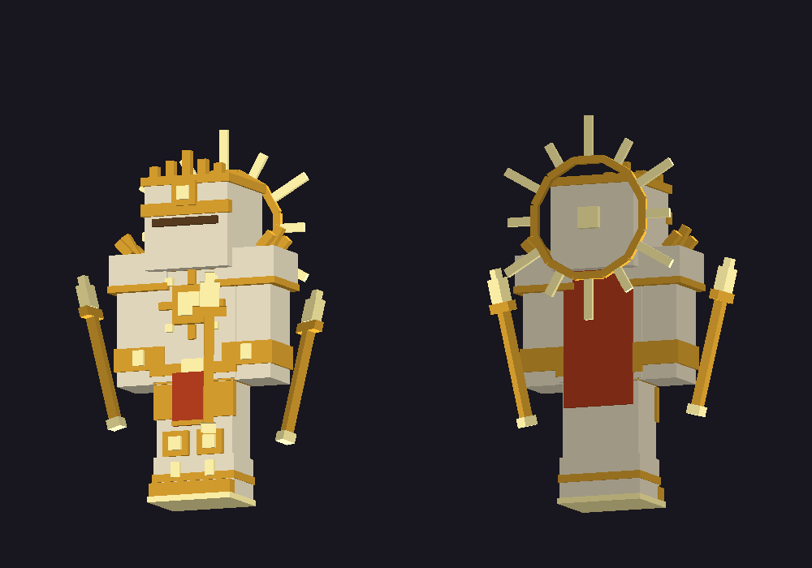

# Vestments of the Unshadowed

A Sun-pathway companion to the [Vestments of the Inevitability](INEVITABILITY_ARMOR.md): ivory and gold
plate, a crimson tabard and cape, a sun halo of twelve rays that slowly turns behind the helm, and three
golden Spears of Light that orbit the wearer's waist. The worn armor uses its own native humanoid rig;
each inventory item has a volumetric model derived from it.



Generated geometry preview of the rig and idle spears with flat material colors. Regenerate it with
`python tools/model_gen/unshadowed_armor/preview.py`.

## Obtaining and repairing

Craft **four Sunfire Cores**:

```text
Gold Block   Glowstone     Gold Block
Blaze Rod    Nether Star   Blaze Rod
Gold Block   Glowstone     Gold Block
```

At a smithing table, combine a **Netherite Upgrade Smithing Template**, the corresponding **Netherite
armor piece** and **one core**. Repair with **Gold Blocks** in an anvil. The set is in the **Sealed
Artifacts** creative tab.

IDs: `circle_of_inevitability:unshadowed_helmet`, `unshadowed_chestplate`, `unshadowed_leggings`,
`unshadowed_boots`, and `unshadowed_core`.

## Combat

| Equipment | Reach | Damage per strike | Minimum strike interval |
| --- | --- | --- | --- |
| Cuirass, with any other armor | 5 blocks | 5 | 30 ticks / 1.5 seconds |
| All four pieces | 6 blocks | 7 | 20 ticks / 1 second |

The spears out-reach the tentacles but hit softer. After an eight-tick windup all three fly tip-first
from their places in the orbit to one nearby hostile, then return. **Undead take double damage and burn
for four seconds**, and each hit flashes with light. Targeting, ally protection, line-of-sight checks,
durability cost, interruption and the shared per-wearer cooldown are the same as the Inevitability set
(both run on `TentacleCombat`).

**Full set:** the wearer is *unshadowed*. Blindness and Darkness are removed as soon as they are applied.

Protection, toughness, knockback resistance, durability and enchantability match the Inevitability set.

## Implementation

- `item/armor/UnshadowedArmor.java`: material, set matching, attack profiles, and the purifying `Impact`.
- `item/armor/TentacleCombat.java`: `tickArmor` dispatches on the worn chestplate so the two sets never
  cancel each other's strikes, and applies the full-set ward.
- `client/armor/UnshadowedArmorModel.java`: halo spin and spear orbit/strike animation from the same
  synchronized strike snapshot. Spears are built in code along +Y, 16 model pixels pommel to tip.
- `assets/circle_of_inevitability/armor/unshadowed.rig.json`: resource-pack editable rig. The `halo` bone
  (child of `head`) is spun by the model; keep that name.
- `tools/model_gen/unshadowed_armor/generate.py`: deterministic generator for the rig, texture atlas,
  item models, recipes, translations and tags.

## Verification

```text
./gradlew build                      # includes unshadowedArmorModelTest
./gradlew runGameTestServer -PunshadowedArmorTests
```
