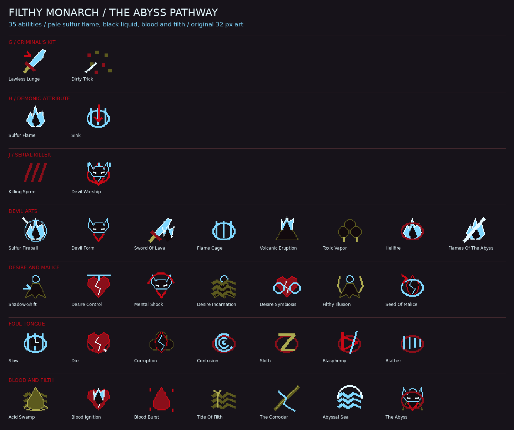

# Filthy Monarch asset collection

Presentation assets for all **35 abilities** in [the supplied design](FILTHY_MONARCH.md): six direct casts and 29 entries across four wheels. This adds the asset library, sound registrations, pathway HUD icon lookup and an operator preview command. It does not implement the pathway's combat, unlocks, counters, summons, cooldowns or seven-key routing. The supplied design is preserved as reference, including its unresolved balance questions.

- 35 distinct transparent 32 × 32 ability icons, seven key icons, 35 ability HUD sprites and 13 status sprites at 16 × 16.
- Depravity and Offerings strips for counts 0–5, plus the pathway icon.
- 51 base models and 28 animation poses (79 model files), with seven compatible four-pose animations: Devil Form, Demon Form, Devil projection, liquid desire, filth phantom, grasping hand and shifting Abyss silhouette.
- Two 64 × 64 material atlases; the Abyss atlas has four vertically stacked frames at four ticks per frame.
- 16 transparent grayscale particle masks, tinted by `FilthyMonarchFx`.
- 59 original mono 44.1 kHz Ogg Vorbis sound cues with English subtitles and registered `ModSounds.FILTHY_MONARCH` events.

Pale sulfur blue `#7FD8FF`, icy core `#E6FAFF`, abyss black `#120A0E`, venetian red `#C80815`, congealed blood `#8A0F1A` and green-brown filth `#5C5A1E`. Fire remains blue and black, including Sword of Lava and Volcanic Eruption. Lava, sludge and sea are visual geometry; the presentation layer never edits blocks.

## Previews



[All models](assets/models.png) · [HUD and particles](assets/hud_particles.png) · [Animated forms](assets/forms.gif) · [Sound sampler](assets/sound_sampler.ogg) ([cue times](assets/sound_sampler.json)).

These are software renders of the actual model geometry and UVs. Each model is framed independently. The Abyss silhouette cycles through a shared abstract form; viewer-specific fear or desire appearances require gameplay/client state that this asset pack does not provide. Full Bloody Archduke and Filthy Monarch mythical forms remain outside the supplied design's scope. Foul Tongue cues are original synthetic formant effects, not intelligible spoken words or actor recordings.

## In-game inspection

Operators can run the following after building the mod:

```text
/filthyfx sulfur_flame
/filthyfx devil_worship
/filthyfx volcanic_eruption
/filthyfx tide_of_filth
/filthyfx abyssal_sea
/filthyfx model demon_form
/filthyfx model corrosive_cloud
/filthyfx sound blather
/filthyfx particles
/filthyfx seeds
/filthyfx stop
```

All ability, model and sound names autocomplete. `model` also exposes upgraded and supporting assets that are not separate wheel entries. Preview casts last up to eight seconds and have no damage, resource costs, movement, summoned AI or terrain changes. `stop` clears models belonging to that player's preview tag; already emitted sprites finish within 30 ticks and one-shot sounds within 2.6 seconds. Forms attached to the local player are best inspected in third person.

## Integration contract

`FilthyMonarchFx.Ability` supplies `id()`, `icon()` and `models()` for every entry. Wheel icon paths are `ability_menus/filthy_monarch/<ability>`; sound event IDs are `circle_of_inevitability:filthy_monarch.<cue>`.

Use `cast(level, caster, targetPoint, ability, ticks, uniqueTag)` for a cast vignette. Callers resolve targets, run warnings at the correct time, own status lifecycles and invoke subsequent hit/channel beats. The preview is a visual inspection tool, not the combat implementation. More precise hooks:

| Hook | Use |
|---|---|
| `model(name, ticks, tag)` | Obtain a configured model for `ParticleShapes`; model units are 16 pixels per block, pivot `(8,0,8)` |
| `form(level, entity, name, ticks, tag, scale)` | Attach an animated skin to an entity; no hitbox, invisibility or AI change |
| `seeds(level, target, count, ticks, tag)` | Replace 0–5 overhead Seed visuals; caller owns per-caster count and expiry |
| `danger(viewer, threat, premonition)` | Private marker and chime for instinct/danger warnings |
| `beam(level, from, to, corrosion, ticks, tag)` | Blue flame or thin corrosion beam fitted to endpoints, capped at 64 blocks |
| `kingdom(level, center, radius, ticks, tag)` | Open shell and black sea; fixed 32-tile geometry budget, radius capped at 32 |
| `melee(level, caster, hit, combo, impact)` | Six visual combo beats with swing/impact sounds |
| `particle(name, argb)` / `sound(level, point, cue)` | Individual tintable sprite or registered sound |
| `end(level, entity, center, tag)` | Clear attached and world models for a cast |

Use a unique tag per cast/field/target owner; reserve separate tags for forms and marks so replacement does not clear unrelated effects. Animated models clamp their lease to 360 ticks to keep the network payload under 64 keys; refresh before expiry. Static models clamp to 6000 ticks. Geometry disappears when its lease expires even if a caller misses cleanup. Do not replay cast audio every tick during channels. The six-hit combo's combat names and damage remain the caller's responsibility.

## Coverage

Each row has a wheel icon, HUD sprite, registered cast sound, FX enum entry and the models listed below. Extra cues cover impacts, passive warnings, seed/Offering changes, rebirth, form endings, barrier corrosion and melee. Upgrade models share their parent ability and are selected explicitly by gameplay.

| Ability ID | Sequence | Models |
|---|---|---|
| `lawless_lunge` | 9 | `claw_slash` |
| `dirty_trick` | 9 | `grit_burst` |
| `sulfur_flame` | 8 | `flame_jet` |
| `sink` | 8 | `sink_seal` |
| `killing_spree` | 7 | `claw_slash`, `bloodlust_crown` |
| `devil_worship` | 7 | `ritual_sigil`, `devil_projection` |
| `sulfur_fireball` | 6 | `sulfur_fireball` |
| `devil_form` | 6 | `devil_form`, `demon_form` |
| `sword_of_lava` | 6 | `lava_sword` |
| `flame_cage` | 6 | `flame_cage` |
| `volcanic_eruption` | 6 | `warning_ring`, `eruption_pillar` |
| `toxic_vapor` | 6 | `toxic_cloud`, `corrosive_cloud` |
| `hellfire` | 4 | `hellfire_pillar` |
| `flames_of_the_abyss` | 1 | `abyss_flame_beam` |
| `shadow_shift` | 5 | `shadow_trail`, `shadow_afterimage` |
| `desire_control` | 5 | `desire_heart` |
| `mental_shock` | 5 | `horn_crown`, `mind_wave` |
| `desire_incarnation` | 5 | `desire_liquid` |
| `desire_symbiosis` | 5 | `symbiosis_link` |
| `filthy_illusion` | 4 | `filth_phantom` |
| `seed_of_malice` | 2 | `malice_seed` |
| `slow` | 6 | `word_slow` |
| `die` | 6 | `word_die`, `blood_spray` |
| `corruption` | 6 | `corrupted_fog` |
| `confusion` | 4 | `word_confusion` |
| `sloth` | 4 | `word_sloth` |
| `blasphemy` | 4 | `word_blasphemy` |
| `blather` | 3 | `word_blather` |
| `acid_swamp` | 4 | `acid_pool` |
| `blood_ignition` | 2 | `burning_heart` |
| `blood_burst` | 2 | `blood_spray` |
| `tide_of_filth` | 1 | `sludge_wave`, `filth_hand`, `sludge_pool` |
| `the_corroder` | 1 | `corrosion_beam`, `barrier_fracture` |
| `abyssal_sea` | 0 | `kingdom_tile`, `black_sea` |
| `the_abyss` | 0 | `abyss_form` |

Additional sound IDs: `demon_form`, `corrosive_fog`, `seed_plant`, `seed_spend`, `offering_gain`, `instinct`, `danger_premonition`, `wingbeat`, `projection_swipe`, `fireball_impact`, `cage_close`, `eruption_warning`, `illusion_burst`, `link_break`, `malice_rebirth`, `single_drop`, `dissolve`, `reform`, `barrier_crack`, `kingdom_close`, `form_end`, `field_end`, `melee_swing`, `melee_impact`.

## Rebuild and validate

Requires Python 3, Pillow, NumPy, FFmpeg and FFprobe. Run from the repository root:

```sh
python tools/model_gen/filthy_monarch/generate.py
python tools/model_gen/filthy_monarch/validate.py
python tools/model_gen/filthy_monarch/preview.py
python tools/model_gen/filthy_monarch/package.py --output build/filthy_monarch_assets.zip
./gradlew build
```

`generate.py --skip-audio` regenerates art while retaining existing sound files. Shared `sounds.json` and `lang/en_us.json` are merged by owned key; other pathways are preserved. The JSON manifest records all owned resource hashes, coverage, animation topology, texture metadata and shared keys. Synthesis uses fixed seeds; decoded waveforms are reproducible, while Vorbis container bytes can vary across FFmpeg runs.

The validator checks all hashes, unique ability icons, dimensions and transparency, valid model bounds/UVs/materials, matching animation topology, moving poses, texture frames, Java sound/ability mappings and all 59 decoded cues for valid mono Vorbis, finite non-silent samples and clipping. `package.py` verifies the ZIP contents and includes only this pack's entries from shared JSON; merge those entries when importing into another checkout.

All artwork, geometry and audio are original procedural assets generated by the checked-in scripts; no downloaded art, samples, voices or music are used. The tools reuse the repository's `modelkit.py` geometry helpers and its UV preview approach. Assets follow this repository's license. The design attribution remains in the supplied document.

Runtime visual QA should inspect first/third person form fit, transparent particles, lighting, sound levels, warnings and effect cancellation using `/filthyfx`. Static validation and compilation do not substitute for that client review.
