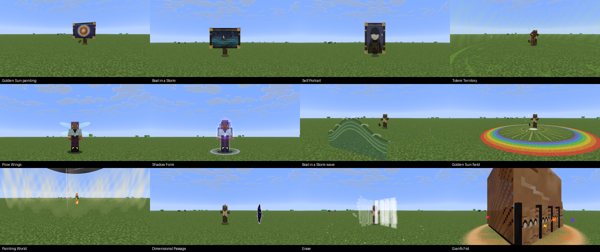

# Observer: ability design

The Observer Pathway is the Sublunary Eye Pathway of Lord of the Mysteries (the High-Dimensional Overseer's Pathway, also called the Painter or Pixie Pathway): Shaman (9), Reporter (8), Painter (7), Literature Enthusiast (6), Pixie (5), Visitor (4), String Player (3), Dimensional Shadow (2), Observer (1), Sublunary Eye (0). Source: the Sublunary Eye Pathway and Sublunary Eye Pathway/Abilities pages of the Lord of the Mysteries wiki.

Every Sequence is built: all seven keys, the two rules (Observation, Paintings), the Territory and every passive. See "What is built" right below for where each part is and where the build differs from the plan. Still to do: the Gallery (folding Paintings) and Beyonder mobs of this Pathway. Every look, sound and picture is made (see "Looks, sounds and pictures" at the end). The rest of this file is the plan: what every ability does, the numbers to start from, which parts of the spell kit build it.

Pathway name in code: `"Observer"` (the Sequence 1 name, as Hand Of God is for the Twilight Giant Pathway).

## What is built

| Part | Where | Notes |
|---|---|---|
| Keys 1 to 7 | `Observer.observerTerritory / observerSight / observerCanvas / observerFiction / observerDimension / observerStrings / observerSublunary` | Wheels `observer_territory`, `observer_sight`, `observer_canvas`, `observer_fiction`, `observer_dimension`, `observer_strings`, `observer_sublunary`, all `selectThenFire().noCooldowns()`. Every entry has a hover text (`.description`). |
| Totem Territory, Borrowed Power (9) | `ObserverTerritory` | The ritual is a 3 second `Countdown`; it is paid when the totem rises, so a broken ritual costs nothing. Radius 16, 20 at 7, 28 at 4, 40 at 2 (enemies inside cannot hide), 64 at 0. A `Dome` shell from 6. Borrowed Power picks the craft by the block or creature in view (12 blocks): water, ice and snow lash; leaves, wood, grass and crops snare; any other block raises spikes; open sky (or nothing in view outdoors) is a gale; indoors with nothing in view, spikes. |
| True Sight, Many Angles (8), Read Intent (7) | `ObserverSight` | Read Intent also reads hung Paintings (anyone's), hidden Traps and Domes. Dossier depth 1 at 7 and 6, 2 at 5 and 4, 3 from 3. |
| Riot of Colours, Itching House, Golden Sun (7), Boat in a Storm, Self Portrait, Giant's Fist (6) | `ObserverCanvas` | Riot of Colours is not spent when it takes someone: it keeps hanging, takes each enemy once, and every second a struck enemy keeps looking adds a Madness (the "prolonged exposure"). The field Paintings' canvas hangs as long as the field lasts (12, 10 and 90 seconds). The Self Portrait echoes casts that are not the Observer's own sight, fiction or Paintings (those would replace your own canvases), within 64 blocks; recasting it while it hangs looks through it (camera preset `observer_self_portrait`, 10 s, free). |
| Painted Mark, Hide in Painting (7), Painted Face, Manifest Knight, Manifest Archer (6) | `ObserverFiction` | A driven mob is walked to the spot for 5 seconds (its own will keeps pulling it back). The figures are `Construct`s on a husk body, hidden under the Knight or Archer model; the Archer's arrows are ability hits from you (10 at Sequence 6, so 5 at 50%), every 1.5 seconds, and it steps back behind the Knight from an enemy within 6 blocks. Painted Face does not hide the name tag yet. |
| Ink Servants, Painting World (5) | `ObserverTerritory` | The servants are three `FollowerSummon`s; their reach (6, 12 in your Territory or Painting World) is checked at each strike. The Painting World is an `Enclosure` (enemies inside also get a 0.75 s Teleport root, renewed); from 2 a `Decree` against PASSAGE and CONCEALMENT binds the enemy too. Not built: the 50% faster spirituality inside a complete world. |
| Fantasy Double (1) | `ObserverFiction` | A husk body `Construct` that is `.shown()`, wears copies of your gear and your name; enemies within 24 blocks are taunted to it every second; `DamageLink.redirect` sends 20% of what it takes to you. |
| Phase, Pixie Wings, Painted Lightning (5), Dimensional Passage, Hostel, Shadow Form (4) | `ObserverDimension` | Phase is the new `status/Phase`; True Sight from 4 (and Sublunary Sight) sees a phased player. Not built: walking through blocks in complete Shadow Form (Phase and Dimensional Passage only, as the Assumptions allow). Shadow Form is a `Form`: the incomplete form's madness rises 3 a second and at 100 (about 33 s) the form gives way, leaving Weakness II and Slowness II for 10 s; from 1 it is +50% size through `Attributes.SCALE` rather than `GiantForm`. Ascension adds 4% to every ability hit and a block to every Strings range. |
| Taut Chord, Resonance, Harmony, Dissonance (3), Shadow From Above, Fold Space (2) | `ObserverStrings` | Harmony arms `NextCast` (free, 120%) for allied players, not for yourself (your next cast would be Harmony's own). |
| Foregone Loss, Foregone Survival, Higher Revival (1), Bloom, Fall Silent, Erase (0) | `ObserverSublunary` | Costs are 60000 for Bloom and Fall Silent and 50000 for Erase, because a full bar holds 78400 from Sequence 2. A boss or a player under Foregone Loss always loses its 15% or 20%. Foregone Survival and Higher Revival share the one `DeathWard` a body can hold: Higher Revival replaces a Foregone Survival on you, and Foregone Survival will not replace a Higher Revival. Higher Revival puts you in Phase for its ritual if you are not already, and is paid when the ritual ends. Bloom keeps Silence and Ability Lock off whoever it holds (not Erase). |
| Phase, Hostel, sealed Death Ward | `status/Phase`, `status/Hostel`, `DeathWard.armSealed` (reusable) | See their class comments and SPELL_KIT.md. |
| Observation | `status/Observation` (reusable) | Built from the crosshair every 5 ticks (`Observer.watch`). The eyes and the watched player's status picture come from its listener. |
| Paintings | `combat/Painting` (reusable) | Stare and limit rules as planned; Observation cuts 0.5 s a level (a `Painting.addStareRule`). |
| Gaze, Territory | `combat/Gaze`, `combat/Territory` (reusable) | Territory's owner bonus is `Territory.addCostScale` (15% off, 30% at 0) and `Territory.addRegen` (30%). |
| Passives 9 to 0 | `SequencePassives` and `Observer` | Spirit Sense (night vision in the dark, the hunted chime), Reporter's Hands (Speed I, 20% faster attacks), Painter's Eye (others' Paintings and hidden Traps within 16 blocks show, and a Painting new to you says who made it in the action bar), Fiction and Reality (Blindness, Nausea, Darkness 40% shorter), Featherfall, Demigod Body, Prayers Heard (players and your own marionettes), Shadow Body, Eyes Everywhere, Sublunary Sight (it also makes True Sight always open, as "Grows with the Sequence" says). |
| Game tests | `ObserverGameTests` | `./gradlew runGameTestServer -PobserverTests` |

Not built yet: the Gallery (folding Paintings), a separate `Manifest` part (the share by Sequence is `ObserverFiction.share`), and Beyonder mobs of this Pathway.

## Theme

A Pathway that looks at the world from one dimension higher. At the bottom it is a Shaman's totem and a Reporter's true sight. In the middle it is Paintings, Imagination and the line between fiction and reality. From Sequence 4 it is Dimensions, then Strings. At the top the Observer decides how what it watches ends, and the Sublunary Eye makes what it sees bloom and what it does not see fall silent.

The wiki ties the Pathway to Wang Yangming's idea that knowledge and action are one. In the kit that becomes one rule: what you keep looking at, you change (see Observation below).

It resembles the Door Pathway (alternate dimensions, space-time) and the Visionary Pathway (alternate worlds and beings) but is not either of them: its power comes from higher Dimensions, so a Painting is a flat world a higher being can edit. Keep it away from Key Of Stars' doors and Knowledge Emperor's study: the Observer's tools are Paintings, Gaze, Phase and Strings.

Colors: ink black and parchment cream for Paintings, earth brown and moss green for Totems, pale teal for the Pixie's wings, black-violet for the Dimensional Shadow, white-gold for the Sublunary Eye. Pathway color: `0x6C5CE7`.

Nothing here breaks blocks or lights real fire. Paintings, the Painting World and the Territory only show and act; the ground is never changed.

## How it is laid out

It follows Star Dragon's wheel pattern, on all seven keys (G H J K L N M):

- Every key is a wheel (`AbilityWheel.create(...).selectThenFire().noCooldowns()`). **Sneak + key opens the wheel** to choose an entry. **The key alone fires the last pick** at its normal cost. The first press with nothing picked opens the wheel.
- **No ability has a cooldown.** Spirituality is the only limit, plus the caps in "Limits instead of cooldowns".
- Because sneak belongs to the wheel, no entry has a sneak form. A toggle (Phase, Wings, Hide in Painting, Shadow Form) is ended by pressing the key again, which is free (`.free(...)`).
- The abilities do not each get a Sequence of their own. Sequences 9 and 8 have two abilities, 7 and 6 have six, 5 has five, 4 has three, 3 has four, 2 has two and also strengthens what is already there (see "Grows with the Sequence"), 1 has four and 0 has three. Sequences 2, 1 and 0 are not left without abilities.
- Costs below are starting values on the scale of Attendant Of Mysteries (250 at Sequence 9, about 350 at 8, 1250 at 7, 2450 at 6, 3000 at 5, 6000 at 4, 12000 at 3), extended upward. Check them against SEQUENCES.md before writing the code.

| Sequence | Abilities |
|---|---|
| Shaman (9) | Totem Territory, Borrowed Power |
| Reporter (8) | True Sight, Many Angles |
| Painter (7) | Read Intent, Riot of Colours, Itching House, Golden Sun, Painted Mark, Hide in Painting |
| Literature Enthusiast (6) | Boat in a Storm, Self Portrait, Giant's Fist, Painted Face, Manifest Knight, Manifest Archer |
| Pixie (5) | Phase, Pixie Wings, Painted Lightning, Ink Servants, Painting World |
| Visitor (4) | Dimensional Passage, Hostel, Shadow Form |
| String Player (3) | Taut Chord, Resonance, Harmony, Dissonance |
| Dimensional Shadow (2) | Shadow From Above, Fold Space |
| Observer (1) | Foregone Loss, Foregone Survival, Higher Revival, Fantasy Double |
| Sublunary Eye (0) | Bloom, Fall Silent, Erase |

## Keys

| Key | Wheel | Entries | Plain press | Sneak + key |
|---|---|---|---|---|
| 1 | Territory | Totem Territory (9), Borrowed Power (9), Ink Servants (5), Painting World (5) | Fires the last pick | Opens the wheel |
| 2 | Sight | True Sight (8), Many Angles (8), Read Intent (7) | Fires the last pick | Opens the wheel |
| 3 | Canvas | Riot of Colours (7), Itching House (7), Golden Sun (7), Boat in a Storm (6), Self Portrait (6), Giant's Fist (6) | Fires the last pick | Opens the wheel |
| 4 | Fiction | Painted Mark (7), Hide in Painting (7), Painted Face (6), Manifest Knight (6), Manifest Archer (6), Fantasy Double (1) | Fires the last pick | Opens the wheel |
| 5 | Dimension | Phase (5), Pixie Wings (5), Painted Lightning (5), Dimensional Passage (4), Hostel (4), Shadow Form (4) | Fires the last pick | Opens the wheel |
| 6 | Strings | Taut Chord (3), Resonance (3), Harmony (3), Dissonance (3), Shadow From Above (2), Fold Space (2) | Fires the last pick | Opens the wheel |
| 7 | Sublunary | Foregone Loss (1), Foregone Survival (1), Higher Revival (1), Bloom (0), Fall Silent (0), Erase (0) | Fires the last pick | Opens the wheel |

Wheel ids for the save data: `observer_territory`, `observer_sight`, `observer_canvas`, `observer_fiction`, `observer_dimension`, `observer_strings`, `observer_sublunary`. Entry keys are lowercase snake_case of the names (`totem_territory`, `riot_of_colours`...). Keep them once players have used them.

## The two rules that carry it

### Observation

Keeping an enemy in your crosshair (`Spells.aimEnemy`, 32 blocks) for 2 seconds without looking away builds one level of Observation on it, up to 3. One level wears off every 8 seconds once you stop watching. It is one player's mark on one enemy (`Marks` with an owner), so two Observers keep their own levels on the same enemy. A small eye per level shows over its head (`SpellFx.overHead`).

| Level | Name | What it does |
|---|---|---|
| 1 | Watched | It cannot hide from you: Concealment, Unnoticed and invisibility on it end every second (`Exposed`), and you see it through walls. |
| 2 | Studied | Your Shots and Rays lead it (`Prediction.grant`), and your ability hits on it do 10% more. |
| 3 | Seen through | Ability hits do 20% more, and it cannot slip away: teleports and passage are held while it is within 24 blocks of you (`Root.addHold`). Foregone Loss and Erase need this level. |

Many Angles, Read Intent and the Observer's passive (Sequence 1) build it faster.

### Paintings

Used by the Canvas wheel and by Hide in Painting, Painted Mark, Self Portrait and Painted Face.

- Painting takes 1 second: strokes are drawn in the air, then a framed 2 x 3 canvas hangs on the block face or in the air where you aim (20 blocks at most, never inside a block).
- A hung Painting waits 45 seconds. It loses a third of its power over its life (full when fresh, two thirds at the end): "Beyonder weapons lose their power over time".
- **Seen:** an enemy within 20 blocks that keeps the canvas in view for 3 seconds straight takes its effect, and the canvas is spent. "In view" is within 55 degrees of its look, with a clear line (`Gaze`). Each Observation level the enemy carries cuts 0.5 seconds off; inside a Painting World it is at once.
- **Field Paintings** (Golden Sun, Boat in a Storm, Self Portrait) work from the moment they hang.
- Up to 3 hung Paintings of each kind at once; a fourth replaces the oldest (`Trap`'s `max` rule).
- **Gallery (second pass):** a Painting can be folded instead of hung and carried (3 at most, kept through relogging, burnt on death). Folded Paintings are `Scrolls` kinds, one per Painting entry, so unfolding is free and instant. Casting a Painting entry at one of your own hung canvases within 4 blocks folds it. Skip this on the first build; nothing else depends on it.

## Wheels

### Key 1: Territory

| Entry | Sequence | Cost | What it does |
|---|---|---|---|
| Totem Territory | Shaman (9) | 250 | Stand still for the ritual: 3 seconds, cancelled with nothing spent if you move more than 2 blocks or are hit. A carved totem with a watching eye rises where you stand and your Territory opens: 16 blocks round it, 6 high. Inside it your spirituality comes back 30% faster, every ability you cast costs 15% less, and every enemy that enters is announced by a soft chime and glows for 2 seconds (only you see it). It lasts until you plant another Totem, die or log out; planting a new one ends the old one. Leaving it costs you nothing. *Built from: `Countdown`, `Zone.at`, `Spells.addCostScale`.* |
| Borrowed Power | Shaman (9) | 250 | Ask what is around you for power. What you look at (12 blocks) decides the craft; with nothing in view the nearest source does. Inside your Territory every craft is 50% stronger. The five crafts are listed under the table. |
| Ink Servants | Pixie (5) | 2000 | Three blurry, faintly glowing servants circle you for 60 seconds. Each strikes the nearest enemy within 6 blocks every 1.5 seconds for 8 damage; the range doubles inside your Territory or Painting World. Casting again replaces them. *Built from: `FollowerSummon.hover`, one name per servant (a caster keeps one follower per name).* |
| Painting World | Pixie (5) | 3000 | A canvas opens in the air where you aim (16 blocks) and for 15 seconds a pocket world of 10 blocks round it exists: black void for a sky, a formless barrier at its edge. Enemies inside cannot walk out (they come back in at the other side) and cannot teleport (a teleport lands them inside). It is incomplete: no rules of its own. Allies and you come and go freely. Cast it again from inside to end it. At Sequence 2 it becomes a complete world (see "Grows with the Sequence"). *Built from: `Enclosure`, `Root` TELEPORT, `Nocturnality.forceNight`, `Zone`.* |

**Borrowed Power crafts** (all cost 250):

| Source you look at | Craft | Effect |
|---|---|---|
| Open sky | Gale | A cone 12 blocks long: 6 damage, throws enemies and their projectiles back (`Spells.hostileShotsAround`). |
| Stone, dirt, sand | Earth Spike | A line of spikes 14 blocks long, 14 damage each, roots for 1.5 seconds. |
| Water, ice, snow | Water Lash | A jet at the enemy in sight (20 blocks): 12 damage, Slowness II for 4 seconds, puts out fire on everyone it passes. |
| Leaves, logs, grass, crops | Thorn Snare | A 4 block circle where you aim: roots for 2.5 seconds, 2 damage a second, plants grow in it (`Spells.growPlants`). |
| A mob or animal | Beast Call | The creature you look at (not a boss, not a player) fights for you for 15 seconds (`Marionette.control`). |

### Key 2: Sight

| Entry | Sequence | Cost | What it does |
|---|---|---|---|
| True Sight | Reporter (8) | 350 | For 12 seconds you see the true nature of things within 24 blocks, and only you see it. Concealed, unnoticed and invisible enemies are outlined. Illusions end on you and cannot be put on you (Blindness, Darkness, Nausea). Marionette strings and Damage Links are drawn as threads. An armed Substitute or Death Ward shows as a small mark over its owner's head. Hidden Traps show. You see, you do not break: nothing is dispelled. Press again to end early (free). *Built from: `ParticleShapes.spawnFor`, `Trap.hiddenNear`, `Marionette.of`, `DamageLink.sharedWith`, `Substitute.isArmed`, `DeathWard.isArmed`.* |
| Many Angles | Reporter (8) | 350 | For 8 seconds every living thing within 32 blocks glows through walls (only you see it), and each one shows a thin line to whatever it is looking at or hunting, red where it is you. Every enemy it shows gains one level of Observation, once per cast. |
| Read Intent | Painter (7) | 1250 | Read what the thing you look at was made to do. Aimed at an enemy (32 blocks): its Dossier in chat, one depth deeper every two Sequences from Painter (body and effects, then defenses, then Beyonder identity, powers and recent casts), and one level of Observation. Aimed at a hung Painting, Trap, Zone, Dome, Decree or construct: who made it, what it will do, how long it has left. *Built from: `Dossier.tell`, `Marks`, `Trap.hiddenNear`.* |

### Key 3: Canvas

All entries are Paintings (see "Paintings"). The damage below is a fresh canvas, before the one-third fade.

| Entry | Sequence | Cost | What it does |
|---|---|---|---|
| Riot of Colours | Painter (7) | 1250 | Seen: a riot of vivid colour. The enemy gets Nausea II and Falter 40% for 6 seconds, and 2 Madness. Every further second it keeps looking adds 1 Madness; at 10 it collapses into Slumber for 5 seconds (prolonged exposure, mental illness). *Built from: `Falter`, `Madness`, `Slumber`.* |
| Itching House | Painter (7) | 1250 | Seen: a triangular house, grey-blue, with trees and rain like mud. Irresistible itching for 8 seconds: Enfeebled 40%, Falter 25%, Slowness I, and it cannot sprint. *Built from: `Enfeebled`, `Falter`.* |
| Golden Sun | Painter (7) | 1250 | A field Painting: a golden-red sun in a ring of colours. A 7 block circle for 12 seconds: allies are warmed (Regeneration I, a cleanse every second); evil and undead are burned for 5 a second and cannot heal; summoned things and marionettes of enemies inside are unmade once (the simple exorcism). *Built from: `Zone`, `Spells.cleanse`, `Spells.isEvil`, `NoHeal`, `Dispel.unmake`.* |
| Boat in a Storm | Literature Enthusiast (6) | 2450 | A field Painting: illusory waves roll out of the canvas. A 9 block circle for 10 seconds: fire goes out on everyone and allies are fire resistant; enemies are slowed (Slowness II) and shoved back by a wave every second. *Built from: `Zone`, `Spells.push`.* |
| Self Portrait | Literature Enthusiast (6) | 2450 | A field Painting of you, 90 seconds, one at a time. Cast again while it hangs to look through it for 10 seconds (the view moves to the canvas, as Star Dragon's Remote Sight does). While it hangs, every ability you cast is repeated from it at 50% (the portrait is moved by your image). *Built from: `Echo.repeat`, `Casts.addListener`, Remote Sight's view.* |
| Giant's Fist | Literature Enthusiast (6) | 3000 | Seen: the painted giant becomes real. A fist 8 blocks wide smashes down on the enemy: 90 damage in 5 blocks, Heavy II for 4 seconds (`Weight`), rooted for 1.5 seconds. Only possible once Paintings are fully real (Sequence 6). *Built from: `Spells.strike`, `Weight.put`, `Root`, `SpellFx.shockRing`.* |

### Key 4: Fiction

| Entry | Sequence | Cost | What it does |
|---|---|---|---|
| Painted Mark | Painter (7) | 1250 (drive 600) | Paint a mark on the creature you look at (24 blocks, a boss takes half as long a mark): marked for 30 seconds, shown as a circle under it (`SpellFx.circleUnder`). Cast again while it is marked to **drive** it: a mob walks to where you aim, or goes after the enemy you aim at (`Taunt`); a player is drawn six blocks toward where you aim (`Reel`). It must stay within 32 blocks of you. *Built from: `Chosen`, `Taunt`, `Reel`, `.costBy`.* |
| Hide in Painting | Painter (7) | 1250 (+40 a second) | A canvas opens on the nearest wall or ground within 3 blocks and you step into it, shown as a human figure in the picture. You are hidden and untouchable (`Concealment`) and held in place (`Root` MOVE). Upkeep 40 a second, 60 seconds at most. Press again to step out (free); casting or attacking also ends it. True Sight sees you. |
| Painted Face | Literature Enthusiast (6) | 1500 | Cosmetics from the Painting: for 60 seconds you are Unnoticed (mobs forget you, abilities cannot pick you; you are seen and can be hurt), and your name is hidden. Aimed at an ally in sight, it is done on them instead. It ends when the one disguised hits something. *Built from: `Unnoticed`, `Spells.aimAlly`.* |
| Manifest Knight | Literature Enthusiast (6) | 2450 | Bring an imagined knight into reality, with only a rudimentary semblance of its power: a tall figure of ink and paper, 30 seconds, one at a time. At Sequence 6 it has 50% of the stats below. Health 80, hits for 12, holds the line in front of you, leash 40 blocks. *Built from: `Construct.of(...)` (body hidden under a model), `.limit`, `.leash`.* |
| Manifest Archer | Literature Enthusiast (6) | 2450 | The same for an archer: 25 seconds, two at a time, health 40, arrows for 10 at 24 blocks, stays behind the Knight when there is one. At 50% power at Sequence 6. *Built from: `Construct.of(...)` with a skeleton body, `.limit`.* |
| Fantasy Double | Observer (1) | 30000 | A fabricated self born of Fantasy stands where you stand, with your face and gear, and every enemy hunts it. You are hidden for 10 seconds (`Concealment`). It lasts 20 seconds. The connection to your true body stays: 20% of what the double takes is dealt to you too (`DamageLink.share`), and a power that reads connections can find you through it. *Built from: the Living Doll pattern (`Construct` with `.shown()`, copied gear, `Taunt`).* |

### Key 5: Dimension

| Entry | Sequence | Cost | What it does |
|---|---|---|---|
| Phase | Pixie (5) | 3000 (+100 a second) | Stabilise one Dimension and slip between the Spirit World and reality. You are invisible, untouchable and hard to detect, can move and fly freely, and cannot interact: any cast, attack or item use ends it. Upkeep 100 a second; it ends at 0 spirituality. Press again to end it (free). True Sight at Sequence 4 and stronger sees you. *Built from: `Concealment`, plus the new `Phase` status (see Reusable parts).* |
| Pixie Wings | Pixie (5) | 1500 | Translucent dragonfly wings: you fly for 60 seconds and take no fall damage after. Press again to fold them (free). *Built from: `Flight`, `ParticleShapes.modelOnTurning`.* |
| Painted Lightning | Pixie (5) | 3000 | Your clothes are the canvas. Three lightning bolts are painted on your sleeve and fly at once: three instant Rays in a narrow fan, 28 damage each, no warning, cannot be dodged. Each jumps to a second enemy within 6 blocks for half. A hit enemy is held for half a second. *Built from: `Ray` with `.warning(0)`, `Spells.turned`, `Root`.* |
| Dimensional Passage | Visitor (4) | 4500 | Step through the higher Dimension: through the wall ahead (8 blocks thick at most), coming out on the far side; with no wall, a blink of 20 blocks toward where you look. No fall damage afterwards. *Built from: `Teleport.throughWall`, `Spells.blinkSpot`, `Teleport.of(...).fallGuard`.* |
| Hostel | Visitor (4) | 6000 lodge, 1500 release | Your body houses a separate Dimension. Aimed at a mob (not a boss, not a player, at most 150 maximum health) below half health, it is lodged in your Hostel: three places, kept with its type and health. With nothing in sight, it releases the oldest guest as a summon at your side for 40 seconds at the health it was lodged with; when the time ends it is lodged again if it lives. Dying empties the Hostel. *Built from: `Marionette.spawnSummon`, `.costBy`, the new `Hostel` part.* |
| Shadow Form | Visitor (4) | 6000 (9000 from Sequence 2) | Your Mythical Creature Form. At Sequence 4 an incomplete Dimensional Shadow: 40 seconds, Speed II, Resistance I, a trail of afterimages, and a madness that rises every second; at full the form ends and you are weakened. It grows with the Sequence (see below). Press again to end it (free). *Built from: `Form`, `Madness`, `HudCounter`.* |

### Key 6: Strings

| Entry | Sequence | Cost | What it does |
|---|---|---|---|
| Taut Chord | String Player (3) | 12000 | Strings are drawn from you to every enemy in sight (6 of them, 28 blocks), pale gold, humming. They pull the caught toward the middle of the web for 8 ticks, hold them for 1.5 seconds, then you play the strings: 45 damage each. *Built from: `Spells.enemiesInSight`, `SpellFx.tether`, `Spells.pull`, `Root`.* |
| Resonance | String Player (3) | 9000 | Pluck the string of one enemy (28 blocks). For 8 seconds it vibrates: every ability hit of yours on it adds a Resonance, up to 5. At 5, or when the time ends, it bursts: 20 damage per Resonance in a 4 block circle and Silence for 2 seconds. *Built from: `Marks` with an owner, `Silence`.* |
| Harmony | String Player (3) | 12000 | A chord for the ones you protect: allies within 16 blocks get Regeneration II for 10 seconds and a cleanse, and the next ability each of them casts is free and 20% stronger. *Built from: `Spells.alliesAround`, `NextCast.arm`.* |
| Dissonance | String Player (3) | 12000 | A broken chord for everyone else within 14 blocks: players are silenced for 3 seconds; mobs have 60% of their attacks go wide and are slowed. Every marionette and construct enemies hold in that circle is shaken loose. *Built from: `Silence`, `Falter`, `Marionette.collapse`.* |
| Shadow From Above | Dimensional Shadow (2) | 20000 | A shadow of a higher Dimension falls into this one. Aimed at an enemy (40 blocks, walls do not matter), a blade of shadow appears inside it with no warning: 120 damage that no shield, substitute or death ward stops. Aimed at the ground, shadow blades rise from below in an 8 block circle for half the damage. 1.5 times as much inside your Painting World. *Built from: `Spells.strikeThrough`, `Spells.aimGround`, `Spells.enemiesAround`.* |
| Fold Space | Dimensional Shadow (2) | 16000 | Fold the plane like paper. Aimed at an enemy or a spot (48 blocks), you instantly stand beside it and everything along the line between is struck for 60 damage and held for 1 second, as if they had been folded. No fall damage. *Built from: `Teleport.of(...).fallGuard().go`, `Spells.enemiesOnLine`.* |

### Key 7: Sublunary

| Entry | Sequence | Cost | What it does |
|---|---|---|---|
| Foregone Loss | Observer (1) | 30000 | Truth: write the ending of one enemy at Observation 3 (without it: "You have not watched it long enough" and nothing is spent). For 12 seconds it cannot heal and takes 25% more from everything. When the 12 seconds end, if it is under 35% of its health it falls (a true hit for what is left); a boss loses 15% of its maximum health instead, and a player 20%. *Built from: `NoHeal`, `Vulnerable`, `Spells.strikeTrue`, `Spells.isBoss`.* |
| Foregone Survival | Observer (1) | 25000 | The ending of an ally (or you, with no one in sight) is written the other way: made whole of harmful effects and warded for 60 seconds: the next death does not happen and they return at 60% health. This is the faster revival arrangement, and it can be disrupted (`Dispel`, a Decree against resurrection). *Built from: `DeathWard.arm`, `Spells.aimAlly`, `Spells.cleanse`, `HudTimer`.* |
| Higher Revival | Observer (1) | 45000 | The slower arrangement through higher Dimensions. Hidden in Phase for an 8 second ritual (leaving Phase ends it, nothing is spent), you set a ward that lasts 10 minutes. When you would die you do not: you return hidden for 3 seconds at 80% health, at your Totem if you have a Territory, else where you fell. It cannot be dispelled and a Decree against resurrection does not stop it. *Built from: `Countdown`, `Phase`, `DeathWard` with the new sealed option.* |
| Bloom | Sublunary Eye (0) | 80000 | "When I see, the flowers bloom." For 20 seconds every ally you can see within 48 blocks (and you) are healed (Regeneration IV), cleansed every second, cut damage by 30% and carry a layer of 10 absorption hearts, and flowers grow across the ground under them. They cannot be silenced or erased while you see them; anyone who leaves your sight loses it. It ends if you are blinded. *Built from: `Spells.alliesAround`, `ConjuredArmor`, `Spells.keepEffect`, `Spells.growPlants`, `Root.addImmunity`.* |
| Fall Silent | Sublunary Eye (0) | 80000 | "When I do not, the flowers and the heart fall silent together." For 10 seconds every enemy within 48 blocks that is **outside your sight** (behind you, behind walls, off screen) falls silent: no abilities, no attacks, limp, and whoever hunted you forgets you. It is worked out every second: whoever comes into your view wakes (their flower blooms), whoever leaves it falls silent again. Anyone silent for the whole 10 seconds is erased from the world for 8 seconds (4 for a boss). *Built from: `Spells.enemiesInSight`, `Silence`, `AbilityLock`, `Slumber` LIMP, `Forgotten`, `Exile`.* |
| Erase | Sublunary Eye (0) | 60000 | A higher being edits the lower Dimension as a person erases a line from a painting. Aimed at an enemy at Observation 3: it is erased from the world for 10 seconds (`Spells.holdLength` rules: half for a boss, 70% for a player) and returns where it stood. Aimed at nothing: everything of the enemy's side that is flat or conjured within 20 blocks of where you aim is unmade: summons, constructs, marionettes, hung Paintings, Domes and Zones (Decrees too). *Built from: `Exile.banish`, `Dispel.isConjured`, `Dispel.unmake`, `Zone.closeNear`, `Dome.raisedAt`.* |

## Grows with the Sequence

These do not get their own key or entry. The same ability is stronger from the Sequence on.

| Ability | From | What changes |
|---|---|---|
| Totem Territory | Painter (7) | 20 blocks across. |
| Totem Territory | Literature Enthusiast (6) | A shell of light rises round it that stops enemy projectiles (`Dome`). |
| Totem Territory | Visitor (4) | 28 blocks. |
| Totem Territory | Dimensional Shadow (2) | 40 blocks, and enemies inside cannot hide. |
| Totem Territory | Sublunary Eye (0) | 64 blocks, and casts inside cost 30% less (15% before). |
| True Sight | Painter (7) | Also shows who made every hung Painting, Trap and Zone in range and what it will do. |
| True Sight | Pixie (5) | 20 seconds. |
| True Sight | Visitor (4) | 30 seconds, and it sees through Phase and Shadow Form. |
| True Sight | Sublunary Eye (0) | No timer: it becomes a passive (see Passives). |
| Every Painting | Literature Enthusiast (6) | Fully real: hangs 90 seconds, effects 30% stronger, the stare is 2 seconds. |
| Every Painting | Pixie (5) | Painting takes 0.4 seconds instead of 1. |
| Every Painting | Dimensional Shadow (2) | Painting is instant, and it cannot be folded away by anyone but you. |
| Painting World | Dimensional Shadow (2) | A complete world: 28 blocks, 45 seconds, living beings can stay inside, and it carries Rules against the enemy (no teleporting, no hiding; `Decree` PASSAGE and CONCEALMENT). Casters inside recover spirituality 50% faster. |
| Painting World | Observer (1) | 36 blocks, 60 seconds. |
| Phase | Visitor (4) | You can take one ally with you (the nearest within 3 blocks when you cast). |
| Phase | Dimensional Shadow (2) | In complete Shadow Form you can also walk through blocks (see Assumptions). |
| Phase | Sublunary Eye (0) | No upkeep. |
| Shadow Form | Visitor (4) | Incomplete: 40 seconds, madness rises, Ascension up to 3. |
| Shadow Form | Dimensional Shadow (2) | Complete: 90 seconds, no madness, Ascension up to 11. |
| Shadow Form | Observer (1) | A faint, unattainably tall humanoid (1.5 times your size, `GiantForm`), and Phase costs nothing in it. |
| Ascension | Visitor (4) | While in Shadow Form a counter (`HudCounter`, "Dimension 4/11") rises by one every 5 seconds. Each level: +4% ability damage and +1 block of range on the Strings wheel. It resets when the form ends. |
| Manifestations | Visitor (4) | 65% of the stats (50% at Sequence 6). |
| Manifestations | Dimensional Shadow (2) | 80%, and the Archer can be had three at a time. |
| Manifestations | Sublunary Eye (0) | Fantasy turned into reality: 100% of the stats. |
| Hostel | Dimensional Shadow (2) | Five places; guests stay out 60 seconds. |
| Observation | Observer (1) | Builds twice as fast. |

## Passives

| Passive | From Sequence |
|---|---|
| Spirit Sense: night vision wherever it is dark (`Nocturnality.darkness`), and a soft chime when something starts hunting you from where you cannot see it | Shaman (9) |
| Reporter's Hands: Speed I and 20% faster attacks | Reporter (8) |
| Painter's Eye: hung Paintings, Traps and Zones of enemies within 16 blocks show who made them and what they do | Painter (7) |
| Fiction and Reality: Blindness, Nausea and Darkness on you last 40% shorter (`EffectDuration.addRule`) | Literature Enthusiast (6) |
| Featherfall: no fall damage, and sneaking in the air slows your fall | Pixie (5) |
| Demigod Body: two more hearts, and Teleport roots on you last half as long (`Root.addDurationScale`) | Visitor (4) |
| Prayers Heard: an ally within 48 blocks that drops under 30% health sends a prayer: a chime, and you see them through walls for 5 seconds | String Player (3) |
| Shadow Body: nothing roots you in place or freezes you (`Root.addImmunity` for MOVE and JUMP, `Freeze.addImmunity`) | Dimensional Shadow (2) |
| Eyes Everywhere: Observation builds twice as fast, and you see every living thing in your Territory through walls | Observer (1) |
| Sublunary Sight: you see every living thing within 64 blocks and nothing hidden stays hidden within 32; attacks aimed at you do 20% less (foreseen) | Sublunary Eye (0) |

## Limits instead of cooldowns

| Ability | Limit |
|---|---|
| Totem Territory | One Territory; planting needs 3 seconds of standing still. |
| Hung Paintings | 3 of each kind (a fourth replaces the oldest). |
| Self Portrait | One at a time. |
| Painted Mark | One mark at a time (`Chosen`). |
| Manifest Knight, Archer | 1 Knight, 2 Archers (`Construct.limit`). |
| Ink Servants | One set of three; casting again replaces it. |
| Hostel | 3 places (5 at Sequence 2). |
| Phase, Wings, Hide in Painting, Shadow Form | Toggles with upkeep. Spirituality at 0 ends them. |
| Foregone Loss, Erase | Need Observation 3: about 4 seconds of watching, lost one level per 8 seconds. |
| Foregone Survival, Higher Revival | One ward each (arming again replaces it). |
| Fantasy Double | One double at a time. |

## Reusable parts

These are worth writing first, because several entries share them and other Pathways will want them. They are described by what they do. Names follow the kit, so they sit beside what is already there.

| Part | Lives in | What it is | Used here by | Useful later for |
|---|---|---|---|---|
| `Gaze` | `combat/` | Who is looking at a point or an entity, and for how long. `Gaze.looking(viewer, point, halfAngle, range)`, `Gaze.watchers(sl, point, radius, halfAngle)`, `Gaze.stare(viewer, key, subject, ticks, onFull)` (accumulates while the look stays, resets when it leaves, fires once). Uses a clear-line check like `Spells.clearLine`. | Painting triggers, Observation, Fall Silent | Medusa-like gazes, "do not look at it" mechanics, evil eyes |
| `Observation` | `status/` | The levels above, built on `Marks` with an owner. `Observation.watch(viewer, target)`, `level`, `spend`, `addListener`. Applies the hit bonus in a `LivingHurtEvent` for ability hits (`Spells.isSpellHit`) and the Level 3 hold through `Root.addHold`. | Sight wheel, Foregone Loss, Erase, Paintings | Any "I have studied you" kit that does not want `Study` or `Appraisal` |
| `Painting` | `combat/` | The hung canvas: `Painting.of(model).kind("riot").seenFor(60).lasts(900).onSeen(viewer -> ...).onField(...).limit(3).hang(player, sl, spot, facing)`. Built from `Trap` (its `max` rule), `Zone`, `Gaze` and a `ModelFx`; owns the one-third fade (`power()`), the Observation stare cut and the Painting World "at once" rule. Folding goes through `Scrolls`. | The whole Canvas wheel, Hide in Painting, Self Portrait | Any placed picture, glyph or sign that something has to look at |
| `Phase` | `status/` | Between the Spirit World and reality: `Concealment` plus "cannot interact" (every cast ends it), an upkeep per second, optional passenger, and `Phase.addSeer((viewer, phased) -> ...)` so powers can see a phased entity without hurting it (True Sight, Shadow Form). | Phase, Hide in Painting, Higher Revival, Shadow Form | Spirit-world pathways, ghosts, any "untouchable until it acts" |
| `Territory` | `combat/` | One home Zone per owner with a bonus for the owner inside it: `Territory.open(player, sl, radius)`, `Territory.inside(player, entity)`, `Territory.addBonus(...)`, `Territory.center(player)`. Built from `Zone.at` and `Spells.addCostScale`. | Totem Territory and all its growth | Sanctuaries, camps, any "my ground" power |
| `Manifest` | `status/` | A figure of fiction: a `Construct` with a translucent ink look and a power share set by the owner's Sequence: `Manifest.of(type).stats(...).power(owner)`. The same figure at 50%, 65%, 80% and 100% needs one place that says the share. | Manifest Knight, Archer, Fantasy Double | Summon kits that grow stronger with the Sequence |
| `Hostel` | `status/` | A short list of lodged creatures per player (entity type, health, name), saved in the player's persistent data, emptied on death: `Hostel.lodge(player, mob, max)`, `release(player)`, `places(player)`. | Hostel | Beast-taming and collection Pathways |
| `DeathWard` sealed option | `status/` | `DeathWard.arm(...).sealed()`: `Dispel` and `Decree` RESURRECTION skip it. | Higher Revival | Any revival that is meant to be hard to disrupt |
| `SpellFx.markFor` | `combat/` | An outline or marker only one viewer sees (`ParticleShapes.spawnFor` underneath): `SpellFx.markFor(viewer, entity, color, ticks)`. | True Sight, Many Angles, Hostel, Prayers Heard | Every "only you see it" sight ability |

Models and textures to make (under `models/model_fx/observer/`, textures in `textures/model_fx/observer/`): the Totem; the framed canvas (one model, each Painting is a texture); the Giant's Fist; the Pixie's wings; an Ink Servant; the Knight and the Archer; the faint Observer figure; the eye for Observation; a taut string; the void sky and barrier ring for the Painting World; the flower for Bloom.

## File plan and wiring

Split the way Star Dragon is, so no class gets huge:

- `Observer.java`: the keys, the seven wheels, the passives, what they share (`ready`, `pay`, cost rules).
- `ObserverTerritory`, `ObserverSight`, `ObserverCanvas`, `ObserverFiction`, `ObserverDimension`, `ObserverStrings`, `ObserverSublunary`: one per wheel.
- `ObserverFx`: every look and sound.

Wiring, following SPELL_KIT.md:

1. Seven ability methods named `observerTerritory`, `observerSight`, `observerCanvas`, `observerFiction`, `observerDimension`, `observerStrings`, `observerSublunary`, each starting with the usual Pathway and Sequence check and then `WHEEL.press(player)`.
2. One call per key in the handlers `SKeyPressAbilityOneUsed` through `SevenUsed`, and seven lines in `PathwayAbilities.ALL`.
3. `"Observer"` into `SequenceCommands.PATHWAYS`, an `ObserverGuide` into `AbilityGuide.PATHWAYS`, and the Sequence table into SEQUENCES.md.
4. Every wheel as `AbilityWheel.create(...).pathway("Observer").selectThenFire().noCooldowns()`, so the catalog sees each entry.
5. Entries that need their own state are `.notCopyable()`: Totem Territory, Phase, Hide in Painting, Shadow Form, Hostel, Painted Mark, Self Portrait, Higher Revival. Everything else may be copied by Record and Replication.
6. Passives through `SequencePassives`, and the body changes (hearts, attack speed) through `Physique.keep`, called once a second for everyone.

## Assumptions to confirm

- All seven keys are wheels, with no single-ability keys. I read "sneak + key opens the wheel, the key alone fires the last pick" as the rule for every key. If you want some keys to keep a normal and sneak cast as Attendant Of Mysteries does, Key 2 (Sight) is the best one to turn back into single casts.
- Costs are guesses on the Attendant Of Mysteries scale; I could not read SEQUENCES.md or the repo.
- Walking through blocks in complete Shadow Form would use the spectator-mode trick Parasite already uses, and give the game mode back the same way. If you do not want that, Shadow Form keeps Phase and Dimensional Passage only.
- The Painting stare (3 seconds in a 55 degree cone) is wide on purpose, because a mob rarely looks at a canvas. Tune `Gaze`'s angle and the stare time in one place.
- Foregone Loss and Erase need Observation 3, so every kill-like ability is gated by about 4 seconds of looking at the enemy.

## Looks, sounds and pictures

Everything the abilities need to look and sound right is built already, in `ObserverFx.java` (`blasphemy_slate/beyonder_characteristics/observer/`). It only shows things. The ability code does the damage, holding, hiding, moving and healing, at the ticks the constants name (`PAINT_TICKS`, `TOTEM_RISEN`, `WORLD_OPEN`, `GIANT_FIST_LANDS`, `MANIFEST_READY`, `WINGS_READY`, `PASSAGE_ARRIVES`, `SHADOW_READY`, `TAUT_PLAYS`, `FOLD_ARRIVES`, `EYE_OPEN`, `ERASE_GONE`), waiting for them with `Later.run`.

Pictures of the rest: [the box models](assets/models.png), [the Paintings](assets/paintings.png), [the picture models](assets/pictures.png), [the wheel, status and Pathway icons](assets/icons.png).

**See them in game** (cheats on): `/observerfx all` plays every display one after another (`/observerfx all 2` twice over), and `/observerfx <name>` plays one (TAB lists the names). Displays that need a target use the nearest mob within 12 blocks, so spawn a zombie or a villager in front of you first. The command is in `ObserverFxGallery.java`: each display is a `Case` there, and each `Case` is also a worked example of the calls one ability makes.

Every timed look takes a `tag` (one per cast: `ObserverFx.tagFor("name")`) and has an `...End` that takes it away early. Looks that only one player should see take a `ServerPlayer viewer`; they show through walls for that player and nobody else.

| Ability | Calls |
| --- | --- |
| Shared: Paintings | `paint(sl, painter, spot, Painting.X, ticks)` (brush strokes for `PAINT_TICKS`, `PAINT_TICKS_PIXIE` from Pixie, 0 = at once), then `hang(sl, Painting.X, spot, facing, ticks, tag)` (the framed canvas at `CANVAS_SCALE`, 3 x 2 blocks; it dims by a third over its life). `paintingStare(sl, painting, canvas, looker, progress)` every 5 ticks while someone looks, `paintingSeen(...)` when it takes hold, `paintingEnd(sl, painting, canvas, tag, spent)`, `foldPainting(...)` for the Gallery. `Painting` holds the 11 canvases: `RIOT_OF_COLOURS`, `ITCHING_HOUSE`, `GOLDEN_SUN`, `BOAT_IN_A_STORM`, `GIANTS_FIST`, `PAINTING_WORLD`, `BLANK`, `SELF_PORTRAIT`, `HIDE_IN_PAINTING`, `HIDE_IN_PAINTING_EMPTY`, `FANTASY`, each with its `accent` colour |
| Shared: Observation | `observed(viewer, target, level, ticks)` (the eyes over the head, one per level, for the watcher alone), `observationRises(viewer, target, level)`, `staring(viewer, target)` while the look holds, `notWatchedEnough(player)` when a cast needs more Observation, `heldInSight(sl, target)` for the Level 3 hold |
| 1 Territory | Totem Territory: `totemRitual(sl, player, ticks, tag)` / `totemRitualCancel`, `totem(sl, ground, radius, ticks, tag)` (risen at `TOTEM_RISEN`), `territoryPulse` every few seconds, `territoryShell` / `territoryShellBlock` from Sequence 4, `intruder(owner, enemy)`, `territoryEnd`. Borrowed Power: `borrow(sl, player, source, Craft.X, boosted)`, then `gale`, `earthSpikes` (one spike every `EARTH_SPIKE_STEP`) / `earthSpikeAt`, `waterLash`, `thornSnare` / `thornSnareEnd`, `beastCall` / `beastCallEnd`. Ink Servants: `inkServantsArrive`, `servantStrike(sl, from, target)`, `inkServantsLeave` (the servants are the `INK_SERVANT` model on `FollowerSummon.hover` at `servantOffset(i)`; `inkServantLooks(sl, player, ticks, tag)` shows them as looks only). Painting World: `paintingWorld(sl, center, radius, ticks, complete, tag)` (open at `WORLD_OPEN`), `worldBarrierHit`, `paintingWorldEnd` |
| 2 Sight | True Sight: `trueSight(sl, player, ticks, tag)`, `trueSightSees(viewer, hidden)`, `trueSightThread(viewer, from, to)`, `trueSightWard`, `trueSightTrap`, `trueSightEnd`. Many Angles: `manyAngles(sl, player, radius, ticks, tag)`, `manyAnglesLine(viewer, looker, lookingAt, atViewer)`, `manyAnglesEnd`. `readIntent(sl, player, thing)` |
| 3 Canvas | `riot` / `madness(sl, victim, level)` / `madnessCollapse` / `riotEnd`; `itching` / `itchingEnd`; `goldenSun` / `sunWarm` / `sunBurn` / `exorcise` / `goldenSunEnd`; `boatInAStorm` / `stormWave` / `boatInAStormEnd`; `selfPortraitLook` / `portraitEcho`; `giantsFist(sl, ground, radius)` (lands at `GIANT_FIST_LANDS`) |
| 4 Fiction | `paintedMark` / `markDrive` / `paintedMarkEnd`; `hideInPainting` / `hideInPaintingEnd`; `paintedFace` / `paintedFaceEnd`; `manifest(sl, construct, Figure.KNIGHT or ARCHER, share, ticks, tag)` (whole at `MANIFEST_READY`, as solid as `share` is strong), `knightStrike`, `archerShot`, `manifestFade`; `fantasyDouble` / `fantasyLink` / `fantasyDoubleEnd` |
| 5 Dimension | `phaseIn` / `phaseTick(phased)` / `phaseOut`; `pixieWings(sl, player, ticks, tag)` (beating at `WINGS_READY`; a model holds at most 64 keys, so call `pixieWingsKeep` every `WINGS_KEPT` ticks while they stay) / `pixieWingsEnd`; `paintedLightning(sl, player, targets)` / `boltJump`; `passage(sl, who, from, to)` (out at `PASSAGE_ARRIVES`); `hostelLodge` / `hostelRelease`; `shadowForm(sl, player, ticks, complete, tag)` (at `SHADOW_READY`), `shadowAfterimage`, `ascension`, `shadowFormEnd`, then `shadowWeakness`; `observerForm` / `observerFormEnd` |
| 6 Strings | `tautChord(sl, player, caught)` then `tautChordPlay` at `TAUT_PLAYS`; `resonance` / `resonanceAdd(sl, target, count, ticks, tag)` / `resonanceBurst`; `harmony` / `harmonyArmed` / `harmonySpent`; `dissonance` / `dissonant`; `shadowFromAbove` / `shadowBladesRise`; `foldSpace(sl, player, from, to)` (arrives at `FOLD_ARRIVES`) / `foldStruck` |
| 7 Sublunary | `foregoneLoss` / `foregoneFall` / `foregoneSpared`; `foregoneSurvival` / `wardSpent`; `revivalRitual` / `revivalArmed` / `higherRevival`; `bloom(sl, player, radius, ticks, tag)` (the Sublunary Eye opens at `EYE_OPEN`) / `bloomOn` / `bloomEnd`; `fallSilent` / `silenced` / `woken` / `fallSilentEnd`; `erase` (gone at `ERASE_GONE`) / `erasedReturn`; `eraseArea` / `unmade` |
| Passives | `spiritChime(viewer, from)`, `featherfall`, `painterEye(viewer, at)`, `prayer(viewer, ally)`, `eyesEverywhere(viewer, seen)`, `sublunarySight(viewer, seen)`, `foreseen(sl, player, from)` |

Statuses above the hotbar: `ObserverFx.status(player, Status.X, ticks)`, `statusForever` for toggles, `statusEnd` to take one away. There are 29: 17 for what the Observer holds (`TERRITORY`, `TRUE_SIGHT`, `MANY_ANGLES`, `HIDDEN`, `PAINTED_FACE`, `SELF_PORTRAIT`, `INK_SERVANTS`, `PHASE`, `PIXIE_WINGS`, `SHADOW_FORM`, `SHADOW_WEAKNESS`, `HARMONY`, `FOREGONE_SURVIVAL`, `HIGHER_REVIVAL`, `BLOOM`, `FALL_SILENT`, `FANTASY_DOUBLE`) and 12 for what is done to others when they are players (`WATCHED`, `STUDIED`, `SEEN_THROUGH`, `MARKED`, `RIOT`, `ITCHING`, `TRAPPED`, `FOREGONE_LOSS`, `RESONATING`, `DISSONANT`, `SILENT`, `ERASED`). The 37 wheel pictures are `ObserverFx.WHEEL_TOTEM_TERRITORY` ... `WHEEL_ERASE`, for `.entry(...)`. The Pathway's icon beside the hotbar is in `PathwayHudIcon` under `"Observer"`.

Two of the reusable parts above are written already, because the looks needed them: `SpellFx.markFor(viewer, entity, color, ticks)` (an outline only one player sees, redrawn every 5 ticks) and `ParticleShapes.modelFor` / `modelOnFor` (a model only one player sees). The sounds are in `ModSounds.OBSERVER`, by name: `ModSounds.observer("giants_fist")`, or `ObserverFx.sound(sl, at, "giants_fist", volume, pitch)`.

What is in the repository, all of it made by the scripts in `tools/model_gen/observer/`. Run `python3 tools/model_gen/observer/generate.py src/main/resources/assets/circle_of_inevitability` from the repository root to remake everything (`--only models,icons` for some parts), then F3+T in game:

| What | Where | Made by |
| --- | --- | --- |
| 16 box-model files (a model with steps is one file per step): the totem, the Giant's Fist, Pixie wings (3 steps), the Ink Servant, the Manifest Knight (2 steps) and Archer (2 steps), the faint Observer figure, the Shadow Form, the Bloom flower (3 steps: bud, half open, open), the shadow blade | `models/model_fx/observer/`, `textures/model_fx/observer/` | `models.py` (+ `textures.py`) |
| 11 framed canvases, one per Painting, sharing one frame (`canvas_frame.png`) with the Painting as a second texture; Riot of Colours, Boat in a Storm and the Painting World are animated | `models/model_fx/observer/canvas_*.json`, `textures/model_fx/observer/paintings/` | `paintings.py` |
| 27 picture-model files (25 pictures, the Sublunary Eye in 3 steps): the Observation eye, the dossier page, the sight ring, the territory circle, the painted mark, the Golden Sun's field, the shadow circle, the taut string, the painted bolt, the Painting World's barrier ring and void sky, the dimensional rift, the fold crease, the Hostel door, the Phase veil, the resonance, chord and dissonance rings, the foregone script, the revival ward, the Sublunary Eye (3 steps), the eraser smear, the riot swirl, the ink wave, the painted face. Many are animated | the same folders | `pictures.py` |
| 37 wheel pictures (32 px), 29 status pictures (16 px), the Pathway icon | `textures/gui/ability_menus/observer/`, `textures/gui/observer/`, `textures/gui/pathway_icons/observer.png` | `icons.py` |
| 15 particle pictures, white so any colour tints them: three brush strokes, a paint splat, an ink blot, an eye shut and open, a totem glyph, a higher-dimension shard, a fold, an eraser crumb, notes, a broken note, a wing glint, a bud | `textures/particle/fx/observer/` | `particles.py` |
| 86 sounds: the totem ritual, drums and rising, the Territory's pulse and shell, every Borrowed Power craft, the Ink Servants, the Painting World opening, holding and closing, brush strokes and painting, a canvas hanging, taking hold and fading, every Painting's own sound, Observation's eyes opening, True Sight, Many Angles, Read Intent, the Painted Mark, Hide in Painting, the Painted Face, the Knight and Archer, the Fantasy Double, Phase, Pixie wings, Painted Lightning, Dimensional Passage, the Hostel, the Shadow Form and its ascension, the Observer's form, the taut string, Resonance, Harmony, Dissonance, Shadow From Above, Fold Space, Foregone Loss and Survival, the revival, the Sublunary Eye opening, Bloom, Fall Silent, Erase and the passives | `sounds/observer/`, `sounds.json` (`observer.*`), subtitles in `lang/en_us.json`, registered in `ModSounds.OBSERVER` | `sounds.py` (it borrows the building blocks of `../beauty_goddess/`, `../knowledge_emperor/`, `../illuminator/` and `../star_dragon/sounds.py`) |

`tools/model_gen/hanged_man/render.py` draws any of the models without the game (it now reads every texture of a model, so the canvases render with their Painting, and the first frame of an animated one).

Things to know when the abilities are written:
- The canvases' fronts face north; `hang` turns them with `facing` (the wall's outward side, or straight up for one on the ground). Wide ones are 3 x 2 blocks at `CANVAS_SCALE`, tall ones (Self Portrait, Hide in Painting, Fantasy) 2 x 3.
- Pixie wings, the Knight, the Archer, the Shadow Form and the Observer figure are worn with `modelOnTurning`; the player's own body is not hidden under them. A body-worn model is drawn for its wearer in first person too (only head-worn ones are hidden), so a Shadow Form shard can cross your own view while you look around.
- `.seeThrough()` washes out a dark texture (an ink-black body came out pale grey-blue in game), so the Ink Servant is solid; keep it for pale, glassy or glowing things.
- The Territory, the Golden Sun, the storm, the Painting World and the silent and blooming fields are not stuck to anyone: end them at the spot they were shown, with the same tag.
