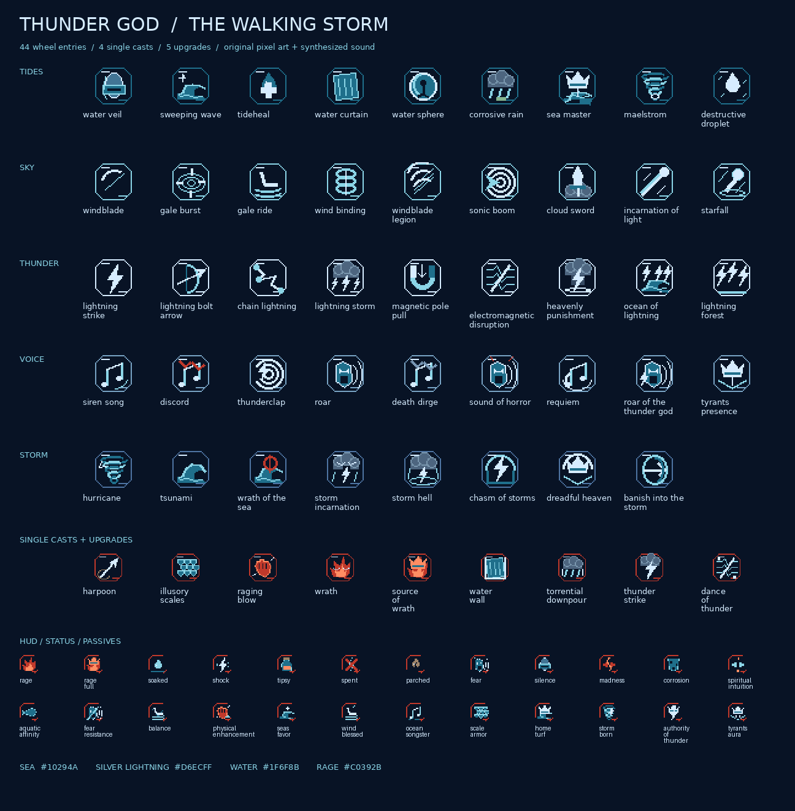

# Thunder God assets

Original pixel art, ModelFx geometry, animated materials and synthesized audio for the
[Thunder God ability design](THUNDER_GOD.md). This delivers the plan's asset needs, including
all 44 wheel entries, both single-key normal/sneak pairs, five upgrade variants, statuses,
passives and the optional melee vocabulary. The supplied design remains a design document:
its questions are not implementation instructions or decisions made by this asset pack.
Sequences 9–0 now use these resources in the [complete playable pathway](THUNDER_GOD_IMPLEMENTATION.md), including higher abilities and summons. Instant casts do not show center-screen icons; timed indicators sit beside the hotbar.



[Model contact sheet](assets/models.png) ·
[Animated material sheet](assets/materials.png) ·
[Wave, whirlpool and kingdom motion](assets/motion.gif)

## Inventory

The [asset manifest](../../../src/main/resources/assets/circle_of_inevitability/thunder_god/asset_manifest.json)
maps every ability to its models, sound and icons, lists pivots and render settings, and hashes
275 individual resources. Paths below start at `src/main/resources/assets/circle_of_inevitability/`.

| Assets | Location | Format |
| --- | --- | --- |
| 27 ModelFx models | `models/model_fx/thunder_god/` | Java block/item JSON, legal cube bounds and rotations |
| 16 materials and 11 animation sidecars | `textures/model_fx/thunder_god/` | RGBA PNG; animations have four vertical frames, three ticks per frame |
| 53 menu icons | `textures/gui/ability_menus/thunder_god/` | 32 × 32; 44 wheel entries, four single casts, five upgrades |
| 77 ability/status/passive glyphs | `textures/gui/thunder_god/` | 16 × 16; includes the ember Rage sigil and stronger-Beyonder warning |
| Seven HUD components | same folder | Three 8 × 8 Rage pips and four transparent 256 × 128 vignettes |
| Pathway icon | `textures/gui/pathway_icons/thunder_god.png` | 16 × 16 silver crown and lightning |
| 17 tintable particle sprites | `textures/particle/fx/thunder_god/` | Transparent grayscale 16 × 16 PNGs |
| 66 registered sound cues | `sounds/thunder_god/` | Mono Ogg Vorbis, 22,050 Hz; English subtitles |

Palette: storm-sea blue `#10294A`, silver-white lightning `#D6ECFF`, water teal `#1F6F8B`,
Rage ember red `#C0392B`. Lightning is always silver-white. No external artwork, wiki imagery,
recordings, licensed voices or downloaded sound effects are included.

## Geometry and animation

Every model ID begins `circle_of_inevitability:model_fx/thunder_god/`. Sixteen model pixels equal
one block; front faces north (-Z). Use the pivot from the manifest; for a sphere or kingdom it
is `(8, 12, 8)`, for standing/ground effects `(8, 0, 8)`, and for cards `(8, 8, 8)`.

| Models | Intended placement |
| --- | --- |
| `harpoon`, `rope_segment` | Barbed spear with tapered tip; align +Y to flight, draw rope to its tail |
| `scale_armor` | Open translucent torso shell; attach with `modelOnTurning` |
| `wave_crest_0` through `_3`, `wave_foam` | Four compatible wave poses with a separate foam lip; tile/scale for Sweeping Wave and Tsunami |
| `water_film`, `water_curtain`, `water_sphere`, `droplet` | Veil panel, tileable wall, hollow voxel sphere, charged water projectile |
| `whirlpool` | Animated spiral surface, two blocks wide at scale 1; rotate it for Maelstrom or tint for floods |
| `warning_ring` | Double-sided ground ring, two-block diameter; scale 7 for the 14-block Starfall warning |
| `rain_sheet` | Transparent local rain card; repeat within the active area |
| `windblade`, `sound_wave` | Faint curved blade and expanding voice-wave cards |
| `storm_cloud`, `cloud_face` | Dark cloud with a separate angry face; the helper combines these for Storm Incarnation |
| `cloud_sword` | Pale cloud sword with tapered tip, pommel and broad guard |
| `lightning_arrow`, `bolt`, `ball_lightning` | Silver arrow, branching zigzag, faceted orb |
| `heavenly_pillar` | Dark pillar segment repeated vertically; drawn bolt arrives separately |
| `kingdom_chasm`, `kingdom_dreadful` | Two translucent shell materials: lightning/teal or dark blue/crown marks |
| `tyrant_crown` | Silver oppression/coronation ornament |

The sphere and shells have a 24-unit diameter (1.5 blocks). Scale `water_sphere` to `3.3333`
for five blocks, and a kingdom to `20` for the design's 30-block diameter.
The model shell is cosmetic; the ability's `Dome` must enforce its boundary.
The sphere construction uses discrete cubes for a Minecraft silhouette.

Play the wave with `ModelFx.of("thunder_god/wave_crest").frames(4).smooth()` and a pose changing
`frame(0)` to `frame(3)` over 12 ticks. All poses have the same named cubes and face topology.
The base name intentionally has no separate JSON, following ModelFx's numbered-pose convention.
Material animation is a separate four-frame `.png.mcmeta` animation and runs automatically.
The preview GIF is a review artifact, not a Minecraft animation file.

Use `.seeThrough()` for transparent water/clouds/cards/shells. Use `.glow().unshaded()` on
lightning, foam, voice waves, warning rings and kingdom tracery. Transparent cards must not
have an aura around their cube bounds. The windblade's low opacity is intentional.

## Cosmetic playback and integration

[`ThunderGodFx`](../../../src/main/java/net/lukario/circleofinevitability/blasphemy_slate/beyonder_characteristics/thunder_god/ThunderGodFx.java)
provides `model`, `bolt`, `wave`, `cloud`, `kingdom`, `cue`, `rage` and `rageEnd` helpers.
These only show things: they do not hurt, move, hold, target or summon entities, change weather,
place water, or create vanilla lightning. Rage displays a supplied integer and performs no accounting.
Call the helpers at the gameplay code's charge, impact and end ticks. The gallery previews components
at a small inspection scale; they are not finished cast choreography.

```java
ThunderGodFx.bolt(level, target.position().add(0, 18, 0), target.position(), .12f, 8);
ThunderGodFx.wave(level, player.position(), player.getYRot(), 3f, 18f, 25);
ThunderGodFx.cloud(level, center.add(0, 12, 0), player.getYRot(), 7f, 200, true);
ThunderGodFx.kingdom(level, center, 15f, 1200, false);
ThunderGodFx.rage(player, 6);
ThunderGodFx.cue(level, center, "heavenly_punishment");
```

Wheel icon keys are `ability_menus/thunder_god/<entry>`, and HUD image keys are
`thunder_god/<entry>` (no extension), matching `AbilityMenu`, `ScreenImages` and `HudCounter`.
The `PathwayHudIcon` mapping is registered under the exact pathway name `Thunder God`.

`ParticleFx` sprite IDs are `fx/thunder_god/<name>`: spark, three arcs, raindrop, splash, foam,
ripple, wind streak, windblade, scale, cloud, rage ember, sound ring, spirit hand, crown and rope.
Tint white sprites using the palette. The optional eight-hit melee combo uses these trails,
`SlashFx` and `melee_swing`; its gameplay and animations are registered by the pathway.

Sound events are `circle_of_inevitability:thunder_god.<cue>`, available via
`ModSounds.THUNDER_GOD.get("<cue>")`. Songs and roars are short synthesized musical/air cues,
not spoken dialogue. `rain_loop`, `wind_loop` and `storm_loop` have a circular crossfade;
gameplay zones schedule ambient cues during their lifetime.
Do not play impact and ambient sounds every tick. Electromagnetic Disruption and Dance of
Thunder have menu/HUD art but deliberately have **no sound or world model**.

In-game review (operator permissions required):

```mcfunction
/thunderfx storm_incarnation
/thunderfx heavenly_punishment
/thunderfx tsunami
/thunderfx bolt
/thunderfx all
/playsound circle_of_inevitability:thunder_god.siren_song master @s ~ ~ ~ 1 1
```

`all` shows 53 casts/upgrades, one every two seconds, including a brief HUD icon.
The preview command itself adds no ability keys or pathway rules.

The giant lightning octopus Mythical Creature Form, Earthquake, Snow Storm and dropped spare
abilities were explicitly outside the supplied design. They are excluded. Sea Master uses the
plan's vanilla creatures; new creature models are not needed. Cloud swords, formations, local
rain, floods and shells supply art without selecting any of the brief's open balance options.

## Regenerate and validate

Python 3 with Pillow and NumPy, plus `ffmpeg` and `ffprobe`, are required. Java builds require
JDK 25 and the repository's Gradle wrapper. Generation is local, uses fixed seeds and preserves
other pathways' sound and translation entries. Ogg stream serial numbers may vary between
encodes; manifest hashes record the actual packaged bytes.

```sh
python3 tools/model_gen/thunder_god/generate.py
python3 tools/model_gen/thunder_god/validate.py
python3 tools/model_gen/thunder_god/preview.py
./gradlew build
python3 tools/model_gen/thunder_god/package.py --output /tmp/thunder-god-assets.zip
```

Validation checks file hashes, resource links, image dimensions and transparency, 44 distinct
wheel icons, cube bounds/UVs/rotations, wave-pose topology, subtitle and Java sound registration,
full Vorbis decoding, signal level and clipping, loop seams and preservation of unrelated
resource entries. Software previews use the actual model geometry and UV textures. Final
sound balance, particle density and transparency should also be reviewed in Minecraft.

The ZIP contains a resource-pack layout, generators, cosmetic Java adapter and review art.
Its `sounds.json` and `en_us.json` include only this pathway's entries: merge them into a mod's
existing files rather than overwriting unrelated entries. The committed repository already
contains those merges and Java registrations. Resource packs alone cannot register Forge
sound events or implement ability behavior.
